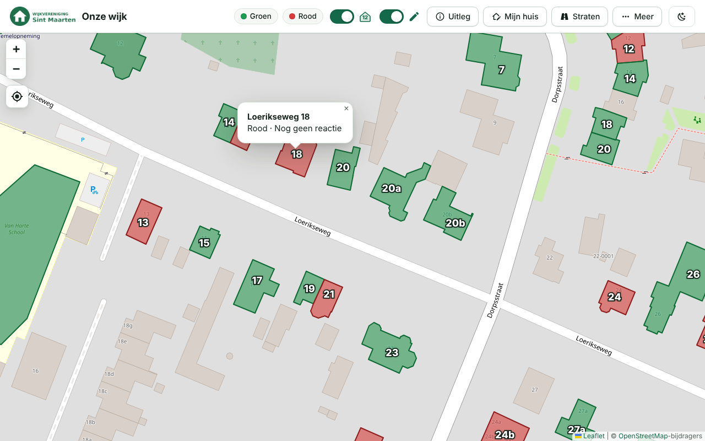
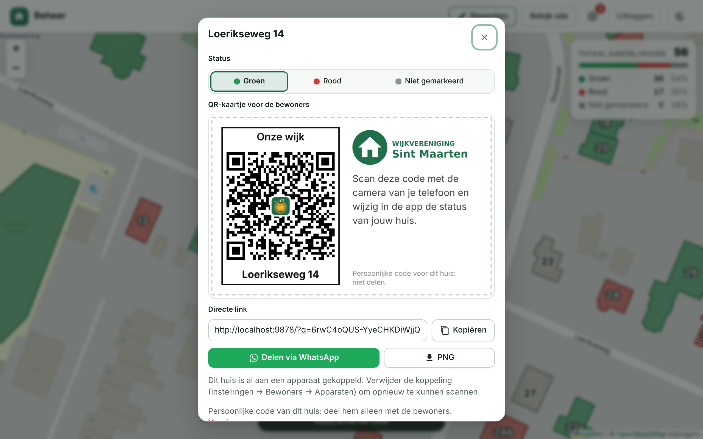
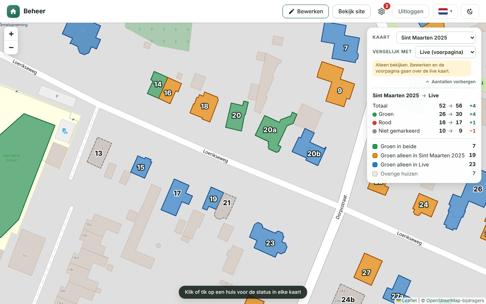
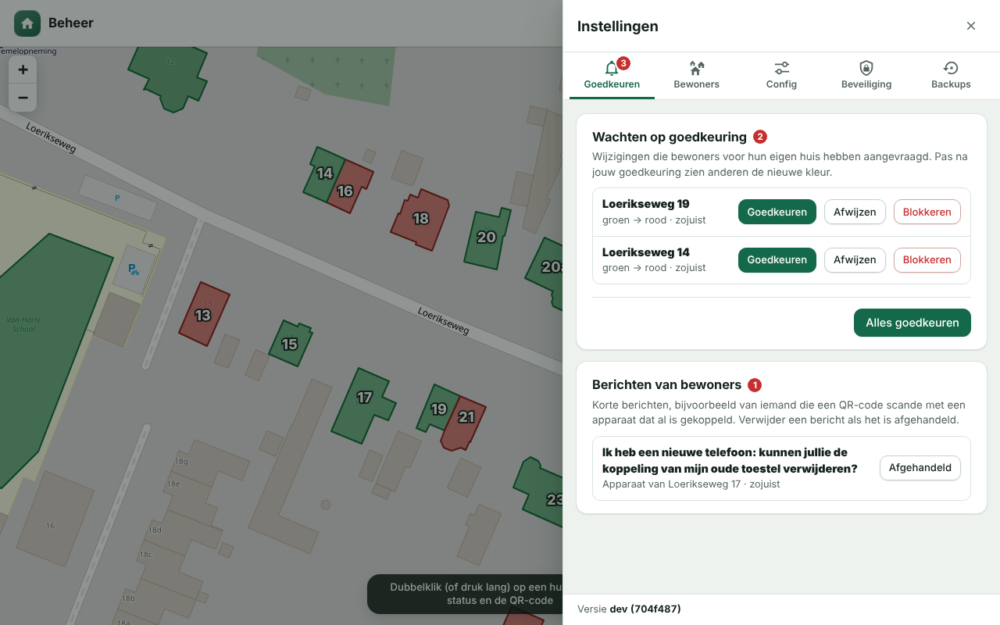
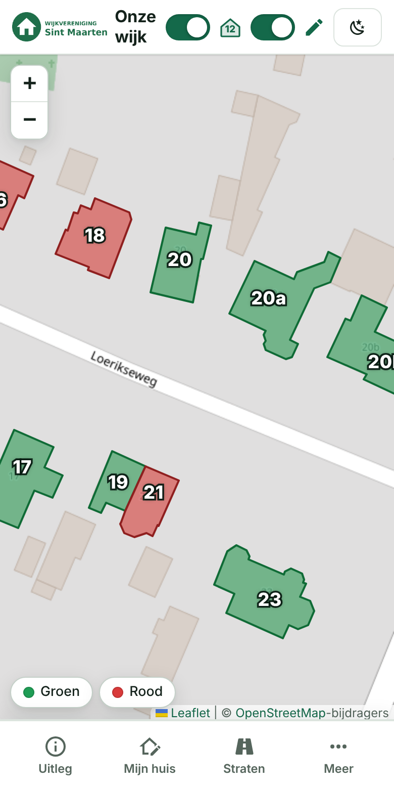
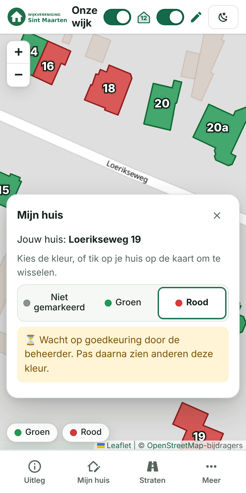
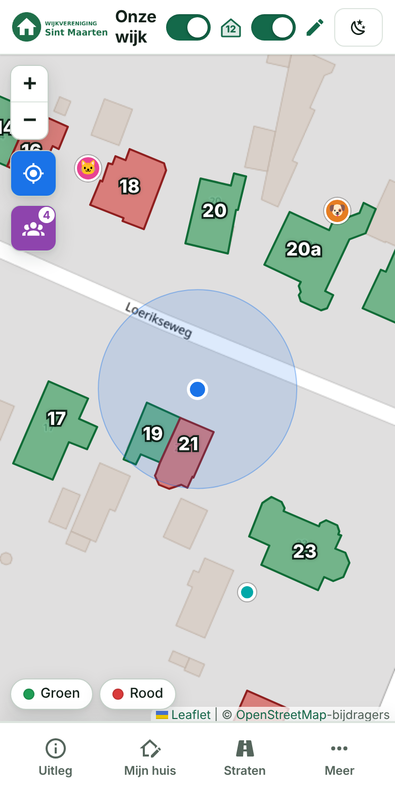
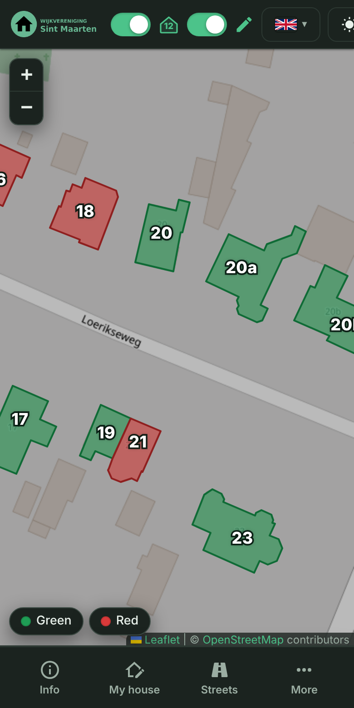
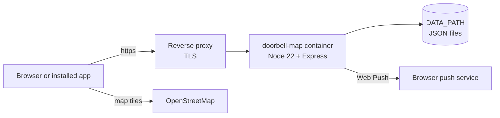

<div align="center">

<picture>
  <source media="(prefers-color-scheme: dark)" srcset="public/icons/icon-512.png">
  
</picture>

# Doorbell Map

**A neighbourhood map that shows, house by house, whether ringing the bell is welcome.**

For Halloween, St. Martin's Day or another door-to-door event: residents set their own house to green or red, and visitors see on their phone where they can ring the bell. You host it yourself, as a single Docker container.

🇳🇱 [Nederlands](README.md) · 🇬🇧 **English**

[](#getting-started)
[](#installation-self-hosted)
[](#features)

[](https://github.com/helmerzNL/Doorbell-Map/commits/beta)
[](https://github.com/helmerzNL/Doorbell-Map/graphs/commit-activity)
[](https://github.com/helmerzNL/Doorbell-Map/forks)
[](https://github.com/helmerzNL/Doorbell-Map/stargazers)
[](https://github.com/helmerzNL/Doorbell-Map/issues)
[](https://github.com/helmerzNL/Doorbell-Map/graphs/contributors)

[](https://github.com/helmerzNL/Doorbell-Map/releases/latest)
[](https://buymeacoffee.com/flux76)
[](https://ko-fi.com/flux76)

[User guide](docs/handleiding.en.md) · [Changes](https://github.com/helmerzNL/Doorbell-Map/releases) · [Report a bug](https://github.com/helmerzNL/Doorbell-Map/issues/new/choose)

<picture>
  <source media="(prefers-color-scheme: dark)" srcset="docs/screenshots/publiek.png">
  
</picture>

</div>

---

## Contents

- [Why Doorbell Map?](#why-doorbell-map)
- [Features](#features)
- [Screenshots](#screenshots)
- [Getting started](#getting-started)
- [Configuration](#configuration)
- [Running it](#running-it)
- [Data and backups](#data-and-backups)
- [Architecture](#architecture)
- [Stable and beta](#stable-and-beta)
- [Contributing](#contributing)
- [Privacy and security](#privacy-and-security)
- [Support Doorbell Map](#support-doorbell-map)
- [License](#license)

## Why Doorbell Map?

On Halloween or St. Martin's Day nobody knows which doors will open. Children ring where it is not convenient, and people who would love visitors get skipped. A list in the neighbourhood chat gets lost and a paper map runs behind. Doorbell Map is one shared map of your own neighbourhood: every house is **green** (ringing welcome), **red** (rather not) or **not marked**. Residents set their own house from their phone, the admin approves it, and visitors see the map in the browser or as an app, offline too. No API key is involved and visitors need no account, and everything runs on your own server.

## Features

- **A map of your own neighbourhood**: every house as a coloured area on OpenStreetMap, with house numbers, a filter per street with the green and red counts, and optionally an overview with counts on the front page.
- **Residents choose for themselves**: a resident sets the status of their own house (one house per device) and the admin approves it, with push notifications. Optionally only via the QR code from the letter, with a location check or an access code, and with an end date.
- **My location and Community**: your own position as a blue dot, so you walk the neighbourhood with one phone. Optionally you share your position live with other participants, without a name and only in the server's memory.
- **A PDF to print**: the map on A4 with legend, counts, logo, explanation and an overview of the houses. Plus a printable PDF with a QR card per house to deliver to the residents.
- **Installable as an app, and offline**: on phone and computer, with the last known map when there is no connection. The admin area is an app of its own too.
- **Dutch and English, light and dark**: a language menu for visitors, texts per language and a dark mode that follows the device.
- **Editions**: keep the map of every year and compare which houses take part then and now, without the front page changing.
- **Secure admin with several admins**: log in with a passkey or with a password and two-step verification. The owner invites others with a link that works once.
- **Automatic backups**: after every save attempt, with short titles, download and restore from the admin area.
- **You stay in control**: everything runs in your own container, and your data lives in one folder on your own server.

Every feature is described in full, with screenshots, in the [user guide](docs/handleiding.en.md).

## Screenshots

| Admin: a house and its QR card | Comparing editions | Approving changes |
|:---:|:---:|:---:|
|  |  |  |

| On the phone | Waiting for approval | Community | English and dark |
|:---:|:---:|:---:|:---:|
|  |  |  |  |

<sub>The screenshots show demo data (map data © OpenStreetMap contributors) in the Dutch interface; the app itself can be switched to English (see [Languages and dark mode](docs/handleiding.en.md#languages-and-dark-mode)). They are made with `node tools/screenshots.js`; see [Contributing](#contributing).</sub>

## Getting started

- 🌐 **Visitors:** open the address of the installation (the value of `ORIGIN`). Click a house for its note, or choose *More → Save PDF*.
- 🏠 **Residents:** double-click (or long-press) your own house, or choose *My house*; see [Residents: My house](docs/handleiding.en.md#residents-my-house).
- 🛠️ **Admin:** open `/beheer` and complete the first start with the setup code; see [The admin area](docs/handleiding.en.md#the-admin-area-beheer).
- 📱 **iPhone / iPad** and 🤖 **Android:** see [Installing as an app](#installing-as-an-app).
- 🐳 **Self-hosting:** see [Installation](#installation-self-hosted).

### Installing as an app

As long as the app is not installed, the menu bar has an **Install** button; nothing opens by itself.

- **Android and computer (Chrome, Edge):** the button starts the browser's installation. If that is not possible, it shows the steps (menu ⋮ → *Install app*).
- **iPhone / iPad:** open the https address in **Safari → Share → Add to Home Screen**; the button shows the same steps.
- Safari on macOS and Firefox cannot install from the page; the button is not shown there.

Installing and working offline only work over **https**. All details: [Installing as an app and offline use](docs/handleiding.en.md#installing-as-an-app-and-offline-use).

### Installation (self-hosted)

On your own Docker environment (NAS, server, Raspberry Pi, VPS), with two files from this repository. There is nothing to build: [GitHub Actions](.github/workflows/docker.yml) publishes the image `ghcr.io/helmerznl/doorbell-map` for amd64 and arm64 (build instructions in the [Dockerfile](Dockerfile)).

```bash
mkdir doorbell-map && cd doorbell-map
curl -O https://raw.githubusercontent.com/helmerzNL/doorbell-map/main/docker-compose.yml
curl -o .env https://raw.githubusercontent.com/helmerzNL/doorbell-map/main/.env.example
# edit .env: at least ORIGIN, SETUP_TOKEN, SESSION_SECRET and DATA_PATH (an absolute folder on the host)
docker compose up -d
```

You can also copy the contents of [`docker-compose.yml`](docker-compose.yml) and [`.env.example`](.env.example) by hand; save `.env.example` as `.env`. `.env` contains secrets and does **not** belong in git.

1. Put a reverse proxy with **https** in front of the port from `PORT` (Synology: *Login Portal → Reverse Proxy*, or Nginx Proxy Manager, Traefik or Caddy), so that `ORIGIN` is correct.
2. Open `ORIGIN/beheer` and complete the first start with the `SETUP_TOKEN`: choose a username and a passkey or password. That first user is the **owner**. If a passkey is not possible (no https or no real domain name), the wizard explains why and you choose the password.
3. Draw the houses and set the map view; see the [user guide](docs/handleiding.en.md#the-admin-area-beheer).

## Configuration

In `.env`; [`.env.example`](.env.example) describes every value.

| Variable | Required | Default | Description |
|---|:---:|---|---|
| `ORIGIN` | ✅ | - | The full URL with which you open the site, exactly as in the browser. Passkeys only work over **https** (or on `localhost`); without https you log in with a username and password |
| `SETUP_TOKEN` | ✅ | - | Secret code for the very first login (the setup wizard), at least 16 characters. Generate one with `openssl rand -hex 12`. Empty or shorter: as long as the setup is not complete, the server makes a temporary code at every start and writes it to the log |
| `SESSION_SECRET` | ✅ | - | Key for signing sessions, at least 16 characters (`openssl rand -hex 32`). Empty: sessions expire at every restart |
| `DATA_PATH` | ❌ | `./data` | Folder on the host for all data. Set an **absolute path** on a local disk (for example `/mnt/user/appdata/doorbell-map`): with Dockge, Portainer, Komodo or Unraid `./data` otherwise lives in the stack manager's folder, and a moved stack starts with an empty folder |
| `DOORBELL_MAP_TAG` | ❌ | `latest` | Which build runs: `latest` (stable), `beta`, or a version number to pin (for example `v1.0.21`). With `beta` a **BETA** label appears next to the name, in the tab title and under the app icon. The old name `SINTMAARTEN_TAG` still works |
| `SITE_TITLE` | ❌ | `Onze wijk` | Name of the site; can be changed later in the admin area |
| `PORT` | ❌ | `9888` | Port of the web server, in the container and on the host |
| `RP_ID` | ❌ | host name from `ORIGIN` | Domain name for the passkeys; only change it if you know why |
| `SESSION_HOURS` | ❌ | `12` | How long a login session stays valid, in hours |
| `MAX_BACKUPS` | ❌ | `200` | How many automatic backups are kept |

## Running it

| Task | Command |
|---|---|
| Start | `docker compose up -d` |
| Stop | `docker compose down` |
| Update | `docker compose pull && docker compose up -d` |
| Roll back | set `DOORBELL_MAP_TAG` to the previous version number (for example `v1.0.33`), then `docker compose up -d` |
| Logs | `docker compose logs -f` |

- **Health check:** `GET /api/auth/status` answers `200` with JSON (including `configured` and `loggedIn`); the image's `HEALTHCHECK` requests it every 30 seconds. `GET /api/version` returns the version, the build and the channel (`stable` or `beta`).
- **Largest upload:** 25 MB (uploading a backup). Logo, small logo and favicon are at most 5 MB, other requests 2 MB. Whatever sits in front of the app (a reverse proxy, a CDN) must allow at least 25 MB.
- **Update check:** the app does not look for new versions itself and never updates itself. New versions are listed under [releases](https://github.com/helmerzNL/Doorbell-Map/releases); the running version is shown at the bottom of the settings menu (⚙).
- **At startup** the server writes to the log which data folder it uses and whether it found data there (`Gegevens: …`). If `/beheer` suddenly asks for the setup code again, or you see errors from old scripts after an update: see [Troubleshooting](docs/handleiding.en.md#troubleshooting).

### Nobody can log in any more?

If the owner has no working passkey, password or recovery code left, reset all login details to a fresh installation. The map, editions, backups and settings stay; all users and invitations are removed. Stop the container first, otherwise the running server writes its data back:

```bash
docker compose stop doorbell-map
docker compose run --rm doorbell-map node server/reset-login.js
docker compose up -d
```

Then open `/beheer`: the setup wizard asks for the setup code (`SETUP_TOKEN`) again. Invite the others again afterwards.

## Data and backups

Everything lives under `DATA_PATH` (`/data` in the container). The container starts briefly as root to restore the permissions on that folder and then runs the app as user `node`.

| Folder or file | What it holds |
|---|---|
| `db.json` | The live map (houses, map view), settings and texts, users, passkeys and invitations, the residents' links, the secrets of the QR codes and the keys for push notifications |
| `secret.key` | The key that encrypts the MFA secret in `db.json`; created the first time MFA is set up |
| `editions/` | One file per edition (100 at most) |
| `backups/` | The automatic and manual backups (JSON) |
| `uploads/` | Logo, small logo and favicon |

**Backups in the admin area.** After every save attempt (houses, texts, map view, editions) the server makes a backup of the layout, the texts and **all editions**. Identical states are not stored twice and the newest 200 are kept (`MAX_BACKUPS`). With many editions a backup gets bigger: count on roughly the size of the live map per edition. In *Settings → Backups* you give a backup a short title, make one yourself, download it or upload a downloaded backup again (25 MB at most). Deleting is confirmed with your passkey or password.

**What is not in it.** A backup in the admin area contains no users, invitations or login details (passkeys, passwords, MFA, recovery codes), no QR secrets and no logo.

**Full backup.** Stop the container and copy the whole `DATA_PATH` folder, with `db.json` **and** `secret.key`: without that key the MFA secret cannot be read.

**Restoring.**
- *From the admin area:* *Settings → Backups → Restore*. The current state is first saved as a backup itself; afterwards exactly the editions from that backup are there. A backup from before editions existed leaves the editions alone.
- *A full backup:* `docker compose down`, put the copied folder back at `DATA_PATH` (`cp -a`, with `db.json` and `secret.key`), then `docker compose up -d`. Check the `Gegevens: …` line in the log.

## Architecture



| Component | Purpose | Data |
|---|---|---|
| `doorbell-map` (Node 22 + Express, one container) | The website, the admin area (`/beheer`), the API and the push notifications to the admin | `DATA_PATH` |
| Browser or installed app (Leaflet, service worker) | The map, the PDFs (made in the browser) and offline use | In the browser: the offline copy, the device token and the visitor's choices |
| OpenStreetMap | Map tiles, fetched directly by the browser; no API key. Keep usage modest ([tile usage policy](https://operations.osmfoundation.org/policies/tiles/)) | - |
| Browser push service | Delivers the push notifications to the admin; the server creates the VAPID keys itself | - |

The declaration on the app-engineering topics (`docs/app-engineering-conformance.md`) does not exist yet.

## Stable and beta

| | Stable | Beta |
|---|---|---|
| Branch | `main` | `beta` |
| Image | `ghcr.io/helmerznl/doorbell-map:latest` (and `vX.Y.Z`) | `ghcr.io/helmerznl/doorbell-map:beta` |
| GitHub release | `vX.Y.Z`, with release notes | none; the app shows `x.y.z-beta` |

Every change lands in `beta` first. Try it in a separate stack with `DOORBELL_MAP_TAG=beta` and its own `container_name`, port, `ORIGIN` and **own `DATA_PATH`**. Do not share the data with your stable installation: a new version may change the data format.

- **Version number:** every successful build on `main` raises the patch number, sets the git tag `vX.Y.Z` and also publishes the image under that tag. The `X.Y` part comes from the `VERSION` file; change that for a new minor or major version, and the counter starts again at 0. Locally (without a build) the app shows `dev` with the commit from git. The workflow needs write access to the repository to set the tag (it is in `docker.yml`).
- **Release notes:** every release on `main` gets release notes automatically from the merged pull requests since the previous release, divided into new features, fixed problems (a `fix/…` branch, or fix/herstel/crash in the title) and documentation (a `docs/…` branch), plus the `docker pull` command. A file `docs/releases/vX.Y.Z.md` replaces the automatic notes (this is how [v1.0.0](docs/releases/v1.0.0.md) was made). To create one again: Actions → *Release* → *Run workflow* with the tag; locally with `node tools/release-notes.js vX.Y.Z` (with `GITHUB_TOKEN` and `GITHUB_REPOSITORY`).
- **Promotion to `main`:** only when the owner asks, with a promotion PR `beta` → `main` and a **merge commit** (never squash), following the [promotion runbook](https://github.com/Flux76HQ/App-Guidance/blob/main/shared/guidelines/promotion-runbook.md).
- **Workflows:** [`docker.yml`](.github/workflows/docker.yml) runs the tests and builds a multi-arch image (amd64 + arm64), plus a `sha` tag, on every push to `beta` or `main`; on `main` it also sets the version tag and creates the GitHub Release. [`release.yml`](.github/workflows/release.yml) creates a release (again) afterwards for an existing tag. [`pr-target.yml`](.github/workflows/pr-target.yml) fails every other PR into `main` with the `only-from-beta` check; the owner makes that check required in the branch protection of `main`.
- **Image cannot be pulled?** If the GHCR package is private, make it public (GitHub → Packages → Package settings) or log in with `docker login ghcr.io` (username and a Personal Access Token with `read:packages`).

## Contributing

Contributions are welcome. Pull requests go to the `beta` branch, never to `main`; work on a `feature/…`, `fix/…` or `docs/…` branch. The working conventions for people and AI assistants are in [`AGENTS.md`](AGENTS.md). For bugs and ideas open an [issue](https://github.com/helmerzNL/Doorbell-Map/issues/new/choose), for questions a [discussion](https://github.com/helmerzNL/Doorbell-Map/discussions).

```bash
npm install
ORIGIN=http://localhost:9888 SETUP_TOKEN=local-test-token-1 npm start
npm test
```

- **Forms:** issues and pull requests follow the forms from [App-Guidance](https://github.com/Flux76HQ/App-Guidance) (`shared/templates/github/`). Issues (`.github/ISSUE_TEMPLATE/`): bug, feature, documentation, regression, performance, chore, release checklist and *PWA / self-hosting*; blank issues are off. Pull requests (`.github/PULL_REQUEST_TEMPLATE.md`): *Summary*, *Deployment files* (changes to Compose or `.env.example` as an instruction for the operator), *Limits*, *Change Spec* and a checklist. The bullets under *Summary* end up in the release notes. GitHub only shows the issue forms from the default branch.
- **Screenshots:** `node tools/screenshots.js` regenerates all screenshots in `docs/screenshots/` (Playwright + Chromium and internet for the map tiles; the example data is in `tools/screenshots/`, the buildings come from OpenStreetMap). With one or more words after it you only make those, for example `node tools/screenshots.js qr`.
- **Translations:** the source of all texts is Dutch; [`public/js/lang-en.js`](public/js/lang-en.js) translates (key = Dutch text). `npm test` checks that every translation has the same variables.
- **Icons:** make a new app icon with `python3 tools/make-icons.py`.

## Privacy and security

- Everything lives on your own server: no account with us, no analytics, no tracking. The browser fetches the map tiles directly from OpenStreetMap.
- **Visitors** have no account. *My location* stays on the phone; only those who choose the Community share their position, without a name. The server keeps those positions in memory only and erases them as soon as someone stops, closes the page or is silent for 45 seconds.
- **Residents:** the server stores only a random device token (as a hash), the IP address of the last request (to be able to block) and the chosen house; no names or other personal data.
- **Admins:** passkeys via WebAuthn ([SimpleWebAuthn](https://simplewebauthn.dev/)), passwords as a `scrypt` hash, two-step verification via TOTP ([otpauth](https://github.com/hectorm/otpauth)) with an encrypted secret and hashed recovery codes. The session cookie is `HttpOnly`, `SameSite=Strict` and `Secure`, with a session epoch per user (a new password, MFA change or reset signs out the other sessions). Changes get an origin check, and failed attempts are limited per IP address and globally. User management follows [App-Guidance: user management](https://github.com/Flux76HQ/App-Guidance/blob/main/shared/guidelines/user-management.md).
- The access code, the location check and *only in the installed app* are restrictions of use, not hard security; every change by a resident goes past the admin.
- Report a vulnerability confidentially through a [private security advisory](https://github.com/helmerzNL/Doorbell-Map/security/advisories/new), never in a public issue.

## Support Doorbell Map

Doorbell Map is free. Is it useful to you? A coffee keeps the development going.

<a href="https://buymeacoffee.com/flux76"></a>
<a href="https://ko-fi.com/flux76"></a>

## License

No licence has been chosen yet: all rights reserved.

Map data © [OpenStreetMap contributors](https://www.openstreetmap.org/copyright). The icons in the settings come from [Material Design Icons](https://pictogrammers.com/library/mdi/) (Apache License 2.0).

---

<div align="center">
<sub>Made with ❤️ in the Netherlands by <a href="https://flux76.com">Flux76</a></sub>
</div>
