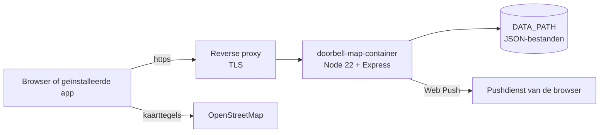

<div align="center">

<picture>
  <source media="(prefers-color-scheme: dark)" srcset="public/icons/icon-512.png">
  
</picture>

# Doorbell Map

**Een wijkkaart die per huis laat zien of aanbellen welkom is.**

Voor Sint Maarten, Halloween of een andere deur-aan-deur-actie: bewoners zetten hun eigen huis op groen of rood, en bezoekers zien op hun telefoon waar ze kunnen aanbellen. Je host hem zelf, als één Docker-container.

🇳🇱 **Nederlands** · 🇬🇧 [English](README.en.md)

[](#snel-starten)
[](#installatie-zelf-hosten)
[](#wat-kan-het)

[](https://github.com/helmerzNL/Doorbell-Map/commits/beta)
[](https://github.com/helmerzNL/Doorbell-Map/graphs/commit-activity)
[](https://github.com/helmerzNL/Doorbell-Map/forks)
[](https://github.com/helmerzNL/Doorbell-Map/stargazers)
[](https://github.com/helmerzNL/Doorbell-Map/issues)
[](https://github.com/helmerzNL/Doorbell-Map/graphs/contributors)

[](https://github.com/helmerzNL/Doorbell-Map/releases/latest)
[](https://buymeacoffee.com/flux76)
[](https://ko-fi.com/flux76)

[Handleiding](docs/handleiding.md) · [Wijzigingen](https://github.com/helmerzNL/Doorbell-Map/releases) · [Een fout melden](https://github.com/helmerzNL/Doorbell-Map/issues/new/choose)

<picture>
  <source media="(prefers-color-scheme: dark)" srcset="docs/screenshots/publiek.png">
  
</picture>

</div>

---

## Inhoud

- [Waarom Doorbell Map?](#waarom-doorbell-map)
- [Wat kan het?](#wat-kan-het)
- [Zo ziet het eruit](#zo-ziet-het-eruit)
- [Snel starten](#snel-starten)
- [Configuratie](#configuratie)
- [Beheer](#beheer)
- [Data en back-ups](#data-en-back-ups)
- [Architectuur](#architectuur)
- [Stabiel en beta](#stabiel-en-beta)
- [Meewerken](#meewerken)
- [Privacy en beveiliging](#privacy-en-beveiliging)
- [Steun Doorbell Map](#steun-doorbell-map)
- [Licentie](#licentie)

## Waarom Doorbell Map?

Bij Sint Maarten of Halloween weet niemand welke deuren opengaan. Kinderen bellen aan waar het niet uitkomt, en wie juist graag bezoek krijgt, wordt overgeslagen. Een lijst in de buurtapp raakt zoek en een kaart op papier loopt achter. Doorbell Map is één gedeelde kaart van je eigen wijk: elk huis is **groen** (aanbellen welkom), **rood** (liever niet) of **niet gemarkeerd**. Bewoners zetten hun eigen huis vanaf hun telefoon, de beheerder keurt dat goed, en bezoekers zien de kaart in de browser of als app, ook offline. Er komt geen API-sleutel aan te pas en geen account voor bezoekers, en alles draait op je eigen server.

## Wat kan het?

- **Een kaart van je eigen wijk**: elk huis als gekleurd vlak op OpenStreetMap, met huisnummers, een filter per straat met de aantallen groen en rood, en desgewenst een overzicht met aantallen op de voorpagina.
- **Bewoners kiezen zelf**: een bewoner zet de status van het eigen huis (één huis per apparaat) en de beheerder keurt dat goed, met pushmeldingen. Optioneel alleen via de QR-code uit de brief, met een locatiecontrole of een toegangscode, en met een einddatum.
- **Mijn locatie en Community**: je eigen positie als blauwe stip, zodat je met één telefoon de wijk door loopt. Optioneel deel je je positie live met andere deelnemers, zonder naam en alleen in het geheugen van de server.
- **PDF om af te drukken**: de kaart op A4 met legenda, aantallen, logo, uitleg en een overzicht van de huizen. Daarnaast een afdrukbare PDF met een QR-kaartje per huis om bij de bewoners te bezorgen.
- **Installeerbaar als app en offline**: op telefoon en computer, met de laatst bekende kaart als er geen verbinding is. Ook het beheer is een eigen app.
- **Nederlands en Engels, licht en donker**: een taalmenu voor bezoekers, teksten per taal en een donkere weergave die het apparaat volgt.
- **Edities**: bewaar de kaart van elk jaar en vergelijk welke huizen toen en nu meedoen, zonder dat de voorpagina verandert.
- **Veilig beheer met meerdere beheerders**: inloggen met een passkey of met wachtwoord en tweestapsverificatie. De eigenaar nodigt anderen uit met een link die één keer werkt.
- **Automatische backups**: na elke opslagpoging, met korte titels, downloaden en terugzetten vanuit het beheer.
- **Jij houdt de regie**: alles draait in je eigen container, en je gegevens staan in één map op je eigen server.

Elke functie staat uitgebreid, met schermafbeeldingen, in de [handleiding](docs/handleiding.md).

## Zo ziet het eruit

| Beheer: een huis en zijn QR-kaartje | Edities vergelijken | Wijzigingen goedkeuren |
|:---:|:---:|:---:|
|  |  |  |

| Op de telefoon | Wacht op goedkeuring | Community | Engels en donker |
|:---:|:---:|:---:|:---:|
|  |  |  |  |

<sub>De schermafbeeldingen tonen demogegevens (kaartgegevens © OpenStreetMap-bijdragers) en worden gemaakt met `node tools/screenshots.js`; zie [Meewerken](#meewerken).</sub>

## Snel starten

- 🌐 **Bezoekers:** open het adres van de installatie (de waarde van `ORIGIN`). Klik op een huis voor de notitie, of kies *Meer → PDF opslaan*.
- 🏠 **Bewoners:** dubbelklik (of druk lang) op je eigen huis, of kies *Mijn huis*; zie [Bewoners: Mijn huis](docs/handleiding.md#bewoners-mijn-huis).
- 🛠️ **Beheerder:** open `/beheer` en doorloop de eerste start met de installatiecode; zie [Het beheer](docs/handleiding.md#het-beheer-beheer).
- 📱 **iPhone / iPad** en 🤖 **Android:** zie [Installeren als app](#installeren-als-app).
- 🐳 **Zelf hosten:** zie [Installatie](#installatie-zelf-hosten).

### Installeren als app

Zolang de app niet geïnstalleerd is, staat er in de menubalk een knop **Installeer**; er opent niets vanzelf.

- **Android en computer (Chrome, Edge):** de knop start de installatie van de browser. Lukt dat niet, dan toont hij de stappen (menu ⋮ → *App installeren*).
- **iPhone / iPad:** open het https-adres in **Safari → Deel → Zet op beginscherm**; de knop toont dezelfde stappen.
- Safari op macOS en Firefox kunnen niet via de pagina installeren; daar staat de knop niet.

Installeren en offline werken gaan alleen via **https**. Alle details: [Installeren als app en offline gebruik](docs/handleiding.md#installeren-als-app-en-offline-gebruik).

### Installatie (zelf hosten)

Op je eigen Docker-omgeving (NAS, server, Raspberry Pi, VPS), met twee bestanden uit deze repository. Bouwen hoeft niet: [GitHub Actions](.github/workflows/docker.yml) publiceert het image `ghcr.io/helmerznl/doorbell-map` voor amd64 en arm64 (bouwinstructies in de [Dockerfile](Dockerfile)).

```bash
mkdir doorbell-map && cd doorbell-map
curl -O https://raw.githubusercontent.com/helmerzNL/doorbell-map/main/docker-compose.yml
curl -o .env https://raw.githubusercontent.com/helmerzNL/doorbell-map/main/.env.example
# pas .env aan: in elk geval ORIGIN, SETUP_TOKEN, SESSION_SECRET en DATA_PATH (een absolute map op de host)
docker compose up -d
```

Je kunt de inhoud van [`docker-compose.yml`](docker-compose.yml) en [`.env.example`](.env.example) ook met de hand kopiëren; `.env.example` sla je op als `.env`. `.env` bevat geheimen en hoort **niet** in git.

1. Zet een reverse proxy met **https** voor de poort uit `PORT` (Synology: *Inloggegevens → Reverse Proxy*, of Nginx Proxy Manager, Traefik of Caddy), zodat `ORIGIN` klopt.
2. Open `ORIGIN/beheer` en doorloop de eerste start met de `SETUP_TOKEN`: kies een gebruikersnaam en een passkey of wachtwoord. Die eerste gebruiker is de **eigenaar**. Kan een passkey niet (geen https of geen echte domeinnaam), dan legt de wizard uit waarom en kies je het wachtwoord.
3. Teken de huizen en stel de kaartweergave in; zie de [handleiding](docs/handleiding.md#het-beheer-beheer).

## Configuratie

In `.env`; [`.env.example`](.env.example) beschrijft elke waarde.

| Variabele | Verplicht | Standaard | Omschrijving |
|---|:---:|---|---|
| `ORIGIN` | ✅ | - | De volledige URL waarmee je de site opent, precies zoals in de browser. Passkeys werken alleen via **https** (of op `localhost`); zonder https log je in met gebruikersnaam en wachtwoord |
| `SETUP_TOKEN` | ✅ | - | Geheime code voor de allereerste inlog (de installatie-wizard), minstens 16 tekens. Maak er een met `openssl rand -hex 12`. Leeg of korter: zolang de installatie niet is afgerond, maakt de server bij elke start een tijdelijke code en zet die in het logboek |
| `SESSION_SECRET` | ✅ | - | Sleutel voor het ondertekenen van sessies, minstens 16 tekens (`openssl rand -hex 32`). Leeg: sessies vervallen bij elke herstart |
| `DATA_PATH` | ❌ | `./data` | Map op de host voor alle gegevens. Zet een **absoluut pad** op een lokale schijf (bijvoorbeeld `/mnt/user/appdata/doorbell-map`): bij Dockge, Portainer, Komodo of Unraid ligt `./data` anders in de map van de stack-beheerder, en een verplaatste stack begint met een lege map |
| `DOORBELL_MAP_TAG` | ❌ | `latest` | Welke build draait: `latest` (stabiel), `beta`, of een versienummer om vast te zetten (bijvoorbeeld `v1.0.21`). Bij `beta` staat er een **BETA**-label bij de naam, in de tabtitel en onder het app-icoon. De oude naam `SINTMAARTEN_TAG` werkt nog |
| `SITE_TITLE` | ❌ | `Onze wijk` | Naam van de site; daarna aan te passen in het beheer |
| `PORT` | ❌ | `9888` | Poort van de webserver, in de container en op de host |
| `RP_ID` | ❌ | hostnaam uit `ORIGIN` | Domeinnaam voor de passkeys; alleen aanpassen als je weet waarom |
| `SESSION_HOURS` | ❌ | `12` | Hoe lang een inlogsessie geldig blijft, in uren |
| `MAX_BACKUPS` | ❌ | `200` | Hoeveel automatische backups er blijven staan |

## Beheer

| Taak | Commando |
|---|---|
| Starten | `docker compose up -d` |
| Stoppen | `docker compose down` |
| Bijwerken | `docker compose pull && docker compose up -d` |
| Terug naar de vorige versie | zet `DOORBELL_MAP_TAG` op het vorige versienummer (bijvoorbeeld `v1.0.33`), dan `docker compose up -d` |
| Logboek | `docker compose logs -f` |

- **Health check:** `GET /api/auth/status` antwoordt `200` met JSON (onder meer `configured` en `loggedIn`); de `HEALTHCHECK` van het image vraagt die elke 30 seconden op. `GET /api/version` geeft de versie, de build en het kanaal (`stable` of `beta`).
- **Grootste upload:** 25 MB (een backup uploaden). Logo, klein logo en favicon zijn maximaal 5 MB, andere verzoeken 2 MB. Wat voor de app staat (een reverse proxy, een CDN) moet minstens 25 MB toelaten.
- **Updatecheck:** de app zoekt niet zelf naar nieuwe versies en werkt zichzelf nooit bij. Nieuwe versies staan bij de [releases](https://github.com/helmerzNL/Doorbell-Map/releases); de versie die draait staat onderin het instellingenmenu (⚙).
- **Bij het starten** zet de server in het logboek welke datamap hij gebruikt en of daar gegevens stonden (`Gegevens: …`). Vraagt `/beheer` ineens weer om de installatiecode, of zie je na een update fouten van oude scripts: zie [Problemen oplossen](docs/handleiding.md#problemen-oplossen).

### Niemand kan meer inloggen?

Heeft de eigenaar geen werkende passkey, wachtwoord of herstelcode meer, zet dan alle inloggegevens terug naar een nieuwe installatie. De kaart, edities, backups en instellingen blijven staan; alle gebruikers en uitnodigingen verdwijnen. Stop eerst de container, anders overschrijft de draaiende server het weer:

```bash
docker compose stop doorbell-map
docker compose run --rm doorbell-map node server/reset-login.js
docker compose up -d
```

Open daarna `/beheer`: de installatie-wizard vraagt weer om de installatiecode (`SETUP_TOKEN`). Nodig de anderen daarna opnieuw uit.

## Data en back-ups

Alles staat onder `DATA_PATH` (in de container `/data`). De container start kort als root om de rechten op die map te herstellen en draait de app daarna als gebruiker `node`.

| Map of bestand | Wat erin staat |
|---|---|
| `db.json` | De live kaart (huizen, kaartweergave), instellingen en teksten, gebruikers, passkeys en uitnodigingen, de koppelingen van bewoners, de geheimen van de QR-codes en de sleutels voor pushmeldingen |
| `secret.key` | De sleutel waarmee het MFA-geheim in `db.json` versleuteld is; aangemaakt bij de eerste keer MFA instellen |
| `editions/` | Eén bestand per editie (maximaal 100) |
| `backups/` | De automatische en handmatige backups (JSON) |
| `uploads/` | Logo, klein logo en favicon |

**Backups in het beheer.** Na elke opslagpoging (huizen, teksten, kaartweergave, edities) maakt de server een backup van de layout, de teksten en **alle edities**. Identieke staten worden niet dubbel bewaard en de nieuwste 200 blijven staan (`MAX_BACKUPS`). Met veel edities wordt een backup groter: reken op ongeveer de grootte van de live kaart per editie. In *Instellingen → Backups* geef je een backup een korte titel, maak je er zelf een, download je hem of upload je een gedownloade backup weer (maximaal 25 MB). Verwijderen bevestig je met je passkey of wachtwoord.

**Wat er niet in zit.** Een backup in het beheer bevat geen gebruikers, uitnodigingen of inloggegevens (passkeys, wachtwoorden, MFA, herstelcodes), geen QR-geheimen en geen logo.

**Volledige back-up.** Stop de container en kopieer de hele map `DATA_PATH`, met `db.json` **én** `secret.key`: zonder die sleutel is het MFA-geheim onleesbaar.

**Terugzetten.**
- *Uit het beheer:* *Instellingen → Backups → Terugzetten*. De huidige staat wordt eerst zelf als backup bewaard; daarna staan er precies de edities uit die backup. Een backup van vóór de edities laat de edities met rust.
- *Een volledige back-up:* `docker compose down`, zet de gekopieerde map terug op `DATA_PATH` (`cp -a`, met `db.json` en `secret.key`), dan `docker compose up -d`. Controleer in het logboek de regel `Gegevens: …`.

## Architectuur



| Onderdeel | Doel | Gegevens |
|---|---|---|
| `doorbell-map` (Node 22 + Express, één container) | De website, het beheer (`/beheer`), de API en de pushmeldingen aan de beheerder | `DATA_PATH` |
| Browser of geïnstalleerde app (Leaflet, service worker) | De kaart, de PDF's (gemaakt in de browser) en het offline gebruik | In de browser: de offline kopie, het apparaat-token en de keuzes van de bezoeker |
| OpenStreetMap | Kaarttegels, rechtstreeks door de browser opgehaald; geen API-sleutel. Houd het gebruik bescheiden ([tile usage policy](https://operations.osmfoundation.org/policies/tiles/)) | - |
| Pushdienst van de browser | Bezorgt de pushmeldingen aan de beheerder; de server maakt zelf de VAPID-sleutels | - |

De verklaring over de app-engineeringonderwerpen (`docs/app-engineering-conformance.md`) is er nog niet.

## Stabiel en beta

| | Stabiel | Beta |
|---|---|---|
| Branch | `main` | `beta` |
| Image | `ghcr.io/helmerznl/doorbell-map:latest` (en `vX.Y.Z`) | `ghcr.io/helmerznl/doorbell-map:beta` |
| GitHub-release | `vX.Y.Z`, met release notes | geen; de app toont `x.y.z-beta` |

Elke wijziging komt eerst in `beta`. Probeer hem in een aparte stack met `DOORBELL_MAP_TAG=beta` en een eigen `container_name`, poort, `ORIGIN` en **eigen `DATA_PATH`**. Deel de gegevens niet met je stabiele installatie: een nieuwe versie kan het gegevensformaat aanpassen.

- **Versienummer:** elke geslaagde build op `main` verhoogt het patchnummer, zet de git-tag `vX.Y.Z` en publiceert het image ook onder die tag. Het deel `X.Y` komt uit het bestand `VERSION`; pas dat aan voor een nieuwe minor- of major-versie, dan begint de teller weer bij 0. Lokaal (zonder build) toont de app `dev` met de commit uit git. De workflow heeft schrijfrechten op de repository nodig om de tag te zetten (staat in `docker.yml`).
- **Release notes:** elke release op `main` krijgt automatisch release notes uit de gemergde pull requests sinds de vorige release, ingedeeld in nieuwe functies, opgeloste problemen (branch `fix/…`, of fix/herstel/crash in de titel) en documentatie (branch `docs/…`), plus het `docker pull`-commando. Een bestand `docs/releases/vX.Y.Z.md` vervangt de automatische notes (zo is [v1.0.0](docs/releases/v1.0.0.md) gemaakt). Opnieuw maken: Actions → *Release* → *Run workflow* met de tag; lokaal met `node tools/release-notes.js vX.Y.Z` (met `GITHUB_TOKEN` en `GITHUB_REPOSITORY`).
- **Promotie naar `main`:** alleen op verzoek van de eigenaar, met een promotie-PR `beta` → `main` en een **merge commit** (nooit squash), volgens de [promotion-runbook](https://github.com/Flux76HQ/App-Guidance/blob/main/shared/guidelines/promotion-runbook.md).
- **Workflows:** [`docker.yml`](.github/workflows/docker.yml) draait de tests en bouwt bij elke push naar `beta` of `main` een multi-arch image (amd64 + arm64), met daarnaast een `sha`-tag; op `main` zet hij ook de versietag en maakt hij de GitHub Release. [`release.yml`](.github/workflows/release.yml) maakt een release achteraf (opnieuw) voor een bestaande tag. [`pr-target.yml`](.github/workflows/pr-target.yml) laat met de check `only-from-beta` elke andere PR naar `main` falen; de eigenaar maakt die check verplicht in de branch protection van `main`.
- **Image niet te downloaden?** Is het GHCR-package privé, maak het dan publiek (GitHub → Packages → Package settings) of log in met `docker login ghcr.io` (gebruikersnaam en een Personal Access Token met `read:packages`).

## Meewerken

Bijdragen zijn welkom. Pull requests gaan naar de branch `beta`, nooit naar `main`; werk op een `feature/…`-, `fix/…`- of `docs/…`-branch. De werkafspraken voor mensen en AI-hulpen staan in [`AGENTS.md`](AGENTS.md). Voor fouten en ideeën open je een [issue](https://github.com/helmerzNL/Doorbell-Map/issues/new/choose), voor vragen een [discussie](https://github.com/helmerzNL/Doorbell-Map/discussions).

```bash
npm install
ORIGIN=http://localhost:9888 SETUP_TOKEN=lokaal-test-token-1 npm start
npm test
```

- **Formulieren:** issues en pull requests volgen de formulieren uit [App-Guidance](https://github.com/Flux76HQ/App-Guidance) (`shared/templates/github/`). Issues (`.github/ISSUE_TEMPLATE/`): bug, feature, documentatie, regressie, performance, chore, release-checklist en *PWA / self-hosting*; lege issues staan uit. Pull requests (`.github/PULL_REQUEST_TEMPLATE.md`): *Summary*, *Deployment files* (wijzigingen in Compose of `.env.example` als instructie voor de beheerder), *Limits*, *Change Spec* en een checklist. De punten onder *Summary* komen in de release notes. GitHub toont de issue-formulieren pas vanaf de standaardbranch.
- **Schermafbeeldingen:** `node tools/screenshots.js` maakt alle schermafbeeldingen in `docs/screenshots/` opnieuw (Playwright + Chromium en internet voor de kaarttegels; de voorbeeldgegevens staan in `tools/screenshots/`, de gebouwen komen uit OpenStreetMap). Met een of meer woorden erachter maak je alleen die, bijvoorbeeld `node tools/screenshots.js qr`.
- **Vertalingen:** de bron van alle teksten is Nederlands; [`public/js/lang-en.js`](public/js/lang-en.js) vertaalt (sleutel = Nederlandse tekst). `npm test` controleert dat elke vertaling dezelfde variabelen heeft.
- **Iconen:** een nieuw app-icoon maak je met `python3 tools/make-icons.py`.

## Privacy en beveiliging

- Alles staat op je eigen server: geen account bij ons, geen analytics, geen tracking. De kaarttegels haalt de browser rechtstreeks bij OpenStreetMap op.
- **Bezoekers** hebben geen account. *Mijn locatie* blijft op de telefoon; alleen wie zelf kiest voor de Community deelt zijn positie, zonder naam. De server houdt die posities alleen in het geheugen en wist ze zodra iemand stopt, de pagina sluit of 45 seconden niets van zich laat horen.
- **Bewoners:** de server bewaart alleen een willekeurig apparaat-token (als hash), het IP-adres van het laatste verzoek (om te kunnen blokkeren) en het gekozen huis; geen namen of andere persoonsgegevens.
- **Beheerders:** passkeys via WebAuthn ([SimpleWebAuthn](https://simplewebauthn.dev/)), wachtwoorden als `scrypt`-hash, tweestapsverificatie via TOTP ([otpauth](https://github.com/hectorm/otpauth)) met een versleuteld geheim en gehashte herstelcodes. De sessiecookie is `HttpOnly`, `SameSite=Strict` en `Secure`, met een sessie-epoch per gebruiker (een nieuw wachtwoord, MFA of reset meldt de andere sessies af). Wijzigingen krijgen een origin-check en mislukte pogingen worden per IP-adres en globaal beperkt. Het gebruikersbeheer volgt [App-Guidance: user management](https://github.com/Flux76HQ/App-Guidance/blob/main/shared/guidelines/user-management.md).
- Toegangscode, locatiecontrole en *alleen in de app* zijn gebruiksbeperkingen, geen harde beveiliging; elke wijziging van een bewoner gaat langs de beheerder.
- Meld een kwetsbaarheid vertrouwelijk via een [privé security advisory](https://github.com/helmerzNL/Doorbell-Map/security/advisories/new), nooit in een openbaar issue.

## Steun Doorbell Map

Doorbell Map is gratis. Heb je er iets aan? Met een koffie houd je de ontwikkeling gaande.

<a href="https://buymeacoffee.com/flux76"></a>
<a href="https://ko-fi.com/flux76"></a>

## Licentie

Er is nog geen licentie gekozen: alle rechten voorbehouden.

De kaartgegevens zijn © [OpenStreetMap-bijdragers](https://www.openstreetmap.org/copyright). De iconen in de instellingen komen uit [Material Design Icons](https://pictogrammers.com/library/mdi/) (Apache License 2.0).

---

<div align="center">
<sub>Met ❤️ gemaakt in Nederland door <a href="https://flux76.com">Flux76</a></sub>
</div>
