# Doorbell Map – interactieve wijkkaart

🇬🇧 [English version of this README](README.en.md)

Een interactieve kaart van de wijk waarop elk huis **groen**, **rood** of **niet gemarkeerd** is (bijvoorbeeld voor Sint Maarten, Halloween of een andere deur-aan-deur-actie: welke huizen willen wel of niet dat er wordt aangebeld). Bezoekers bekijken de kaart in de browser of als app op hun telefoon; de beheerder tekent de huizen en beheert alles in `/beheer`, beveiligd met een **passkey** of **gebruikersnaam en wachtwoord** (optioneel met tweestapsverificatie), en kan anderen als beheerder uitnodigen. Draait als één Docker-container op bijvoorbeeld een NAS: je deployt hem met [`docker-compose.yml`](docker-compose.yml) en een eigen `.env` (kopie van [`.env.example`](.env.example)); zie [Zelf deployen met Docker](#zelf-deployen-met-docker).

## Inhoud
- [Functies in het kort](#functies-in-het-kort)
- [De website voor bezoekers](#de-website-voor-bezoekers)
- [Bewoners: Mijn huis](#bewoners-mijn-huis)
- [Toegang via QR-code](#toegang-via-qr-code-optioneel)
- [Talen en donkere weergave](#talen-en-donkere-weergave)
- [Het beheer](#het-beheer-beheer)
- [Instellingen](#instellingen)
- [Inloggen: passkey, wachtwoord en MFA](#inloggen-passkey-wachtwoord-en-mfa)
- [Meer beheerders uitnodigen](#meer-beheerders-uitnodigen)
- [Auditlog](#auditlog)
- [Edities: eerdere keren vergelijken](#edities-eerdere-keren-vergelijken)
- [Installeren als app en offline gebruik](#installeren-als-app-en-offline-gebruik)
- [Zelf deployen met Docker](#zelf-deployen-met-docker)
- [Releases en release notes](#releases-en-release-notes)

## Functies in het kort

**Voor bezoekers**
- Kaart op basis van OpenStreetMap (geen API-sleutel) met gekleurde vlakken over de huizen; klik op een huis voor de notitie.
- Huisnummers op de kaart (schakelaar), straten-filter met tellingen groen/rood, en een uitleg- en infovenster.
- **PDF** (A4 liggend) met kaart, legenda, aantallen, logo, uitleg en een overzicht van de gemarkeerde huizen, inclusief datum en tijd.
- **Installeerbaar als app (PWA)** met eigen app-icoon en **offline** gebruik; zolang de app niet geïnstalleerd is, staat er een knop *Installeer* in de menubalk (geen melding die vanzelf opent). Zie [Installeren als app](#installeren-als-app-en-offline-gebruik).
- Het **overzicht met aantallen** (totaal en per status) staat, als de beheerder dat aanzet, ook op de voorpagina; een knop naast licht/donker verbergt of toont het blok.
- Werkt op telefoon (menubalk onderin, zwevend statusbalkje) en desktop.
- **Meertalig** (Nederlands en Engels, in te schakelen in het beheer) en een **donkere/lichte weergave** met een knop rechtsboven. Zie [Talen en donkere weergave](#talen-en-donkere-weergave).

**Voor bewoners**
- Bewoners wijzigen de status van **hun eigen huis** (één huis per apparaat); de beheerder keurt dat goed. Zie [Bewoners: Mijn huis](#bewoners-mijn-huis).
- Snel naar je huis met dubbelklikken of lang indrukken.
- De knop **Mijn locatie** (onder de zoomknoppen) toont je eigen positie standaard als blauwe stip, zodat je maar één telefoon nodig hebt.
- Optioneel (door de beheerder aan te zetten): de **Community** om je positie live te delen en de andere deelnemers als stippen te zien, met een eigen kleur en symbool. Zie [Mijn locatie en Community](#de-website-voor-bezoekers).
- Optioneel: huis kiezen **alleen met de QR-code** uit de brief (één apparaat per huis), met locatiecontrole (geofence) en/of een toegangscode voor apparaten zonder GPS. Zie [Toegang via QR-code](#toegang-via-qr-code-optioneel).

**Voor de beheerder**
- Huizen tekenen en bewerken (kleur, straat, huisnummer, notitie, hoekpunten), kaartweergave instellen (midden, zoom, min/max).
- Inloggen met **passkey** of met **gebruikersnaam en wachtwoord**, optioneel met **tweestapsverificatie (MFA)** en herstelcodes. Zie [Inloggen](#inloggen-passkey-wachtwoord-en-mfa).
- **Meerdere beheerders**: de eigenaar nodigt anderen uit met een link; ieder kiest zelf een passkey of wachtwoord. Zie [Meer beheerders uitnodigen](#meer-beheerders-uitnodigen).
- Wijzigingen van bewoners **goedkeuren of afwijzen**, met **pushmeldingen**; apparaten **blokkeren** (ook op IP); wijzigen **plannen** tot een datum en tijd.
- **QR-codes** per huis: tonen, link kopiëren, vernieuwen en een **afdrukbare PDF** met een kaartje per huis om bij de bewoners te bezorgen.
- **Edities**: de kaart van elke keer met naam en jaartal, aangemaakt als kopie van de live kaart of een andere editie en los te bewerken; wissel in het beheer tussen *Live* en edities en vergelijk welke huizen toen en nu meedoen, met de aantallen. De voorpagina verandert daar nooit door. Zie [Edities](#edities-eerdere-keren-vergelijken).
- Instellingen in zeven overzichtelijke tabs; het beheer is ook als eigen **app** te installeren.
- Eigen **logo** (met een optioneel klein logo voor de kopbalk), een optioneel **favicon** (ook het icoon van de geïnstalleerde app; standaard de lantaarn), uitleg, infovlak, **site- en appnaam** en eigen namen voor de statussen.
- Automatische **backups** na elke opslagpoging (ZIP, met app-instellingen, logo's en apparaten), met korte titels en handmatige backups.
- Een **auditlog** in de datamap met elke wijziging en wie hem deed: een beheerder of het apparaat van een bewoner, en per huis wat er veranderde. Zie [Auditlog](#auditlog).
- Versienummer en commit zichtbaar in het instellingenmenu.

## De website voor bezoekers

Voorbeeld met willekeurige huizen (kaartgegevens © OpenStreetMap-bijdragers).

<table>
<tr><td align="center" valign="top"><a href="docs/screenshots/publiek.png">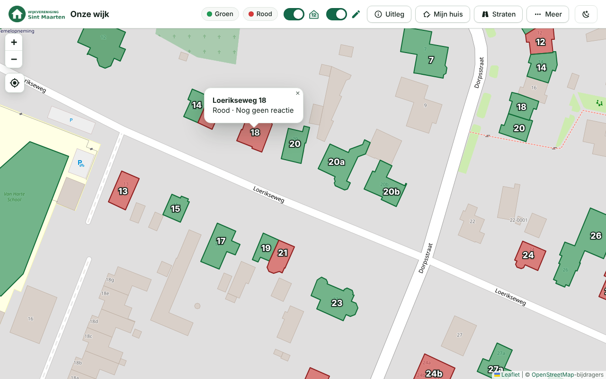</a><br><sub>Publieke kaart</sub></td><td align="center" valign="top"><a href="docs/screenshots/straten-popup.png">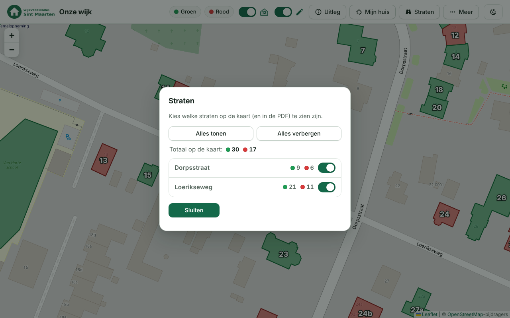</a><br><sub>Straten per straat tonen/verbergen</sub></td><td align="center" valign="top"><a href="docs/screenshots/uitleg.png">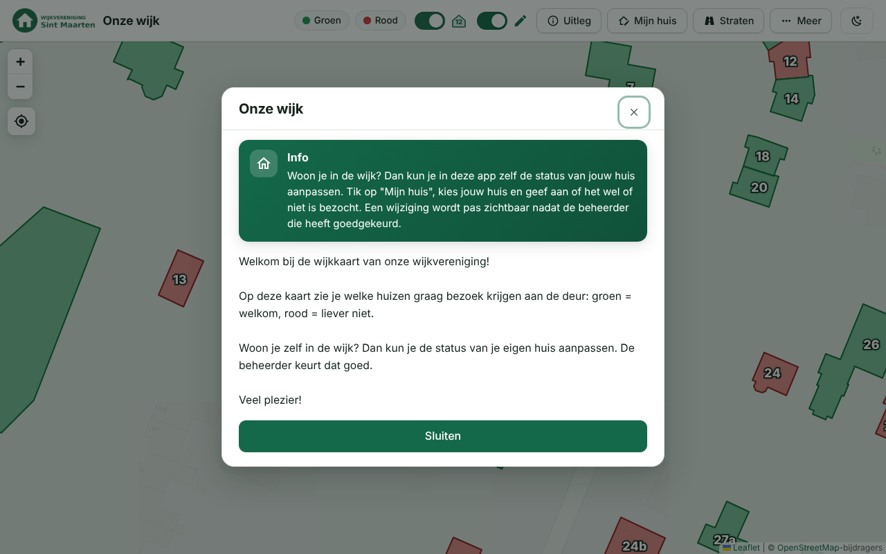</a><br><sub>Uitleg met infovlak</sub></td></tr>
</table>

<table>
<tr><td align="center" valign="top"><a href="docs/screenshots/mobiel.png">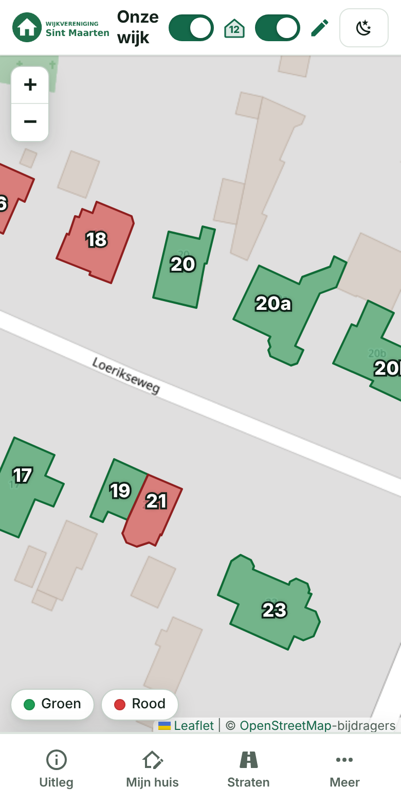</a><br><sub>Mobiel</sub></td><td align="center" valign="top"><a href="docs/screenshots/straten-popup-mobiel.png">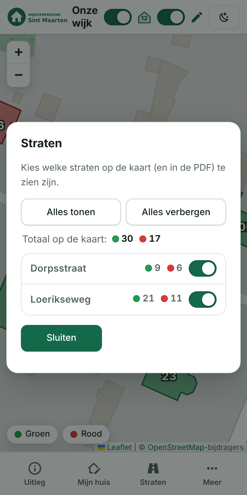</a><br><sub>Straten (mobiel)</sub></td><td align="center" valign="top"><a href="docs/screenshots/info-vlak-mobiel.png">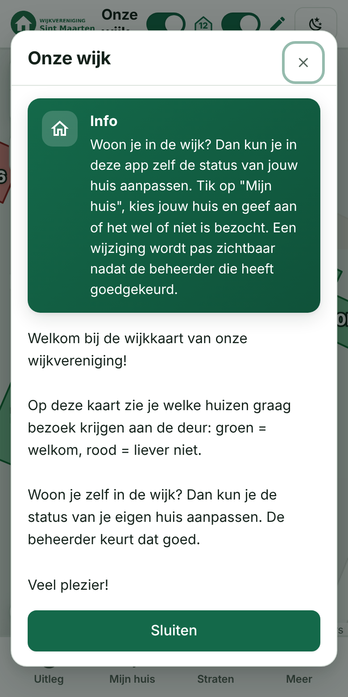</a><br><sub>Infovlak in de uitleg</sub></td></tr>
</table>

**Publieke kaart** – met het logo van de vereniging; klik op een huis voor de notitie. Bovenaan staan de knoppen voor de uitleg, de straten en het menu *Meer* (⋯) met de PDF-knoppen.

**Mobiel** – bovenaan alleen het logo, de titel, de schakelaars voor huisnummers en bewerken en (rechts) de taalkeuze en de donker/licht-knop; de acties (uitleg, straten, Meer) staan onderaan, met het statusbalkje (groen/rood) er altijd net boven.

**Straten** – met het straat-icoon (🛣️) in de menubalk zet je per straat de huizen op de kaart (en in de PDF) aan of uit. Per straat staat hoeveel huizen **groen** en **rood** zijn, en bovenaan het totaal van de zichtbare straten.

**Uitleg en infovlak** – de tekst van de vereniging; wordt de eerste keer automatisch getoond en sluit met het kruisje rechtsboven. Bovenaan staat het opvallende groene **infovlak** dat uitlegt dat bewoners hun eigen huis kunnen wijzigen; dat verdwijnt zodra wijzigen is uitgeschakeld.

**Overzicht met aantallen** – rechtsboven op de kaart staat het *totaal aantal huizen* en per status het aantal en het percentage, met een verdelingsbalk. De beheerder zet het blok voor bezoekers aan met *Ook op de voorpagina tonen* (*Instellingen → Config → Weergave*; standaard uit). Is het zichtbaar, dan staat naast de licht/donker-knop een knop waarmee een bezoeker het blok verbergt of weer toont; die keuze wordt alleen op dat apparaat onthouden.

<table>
<tr><td align="center" valign="top"><a href="docs/screenshots/voorpagina-totaal.png">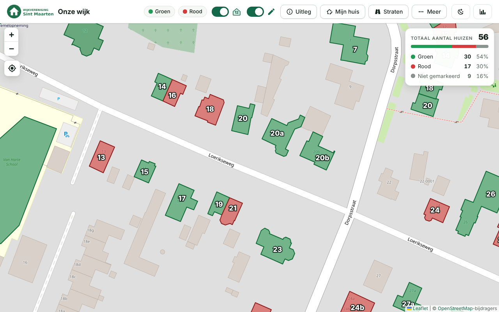</a><br><sub>Overzicht met aantallen</sub></td><td align="center" valign="top"><a href="docs/screenshots/voorpagina-totaal-verborgen.png">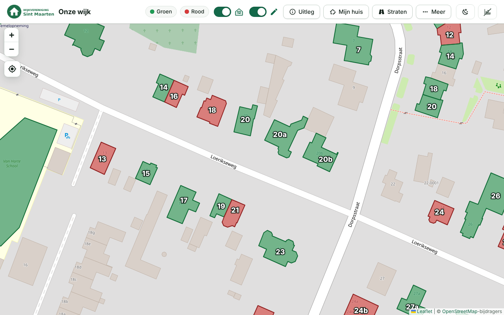</a><br><sub>Verborgen met de knop rechtsboven</sub></td></tr>
</table>

**PDF-export** – A4 liggend met legenda, aantallen en de datum en het tijdstip (HH:MM) van de stand. Pagina 2 bevat het logo, de uitleg en het overzicht van de gemarkeerde huizen. De PDF volgt de gekozen straten en de huisnummers.

<table>
<tr><td align="center" valign="top"><a href="docs/screenshots/pdf.png">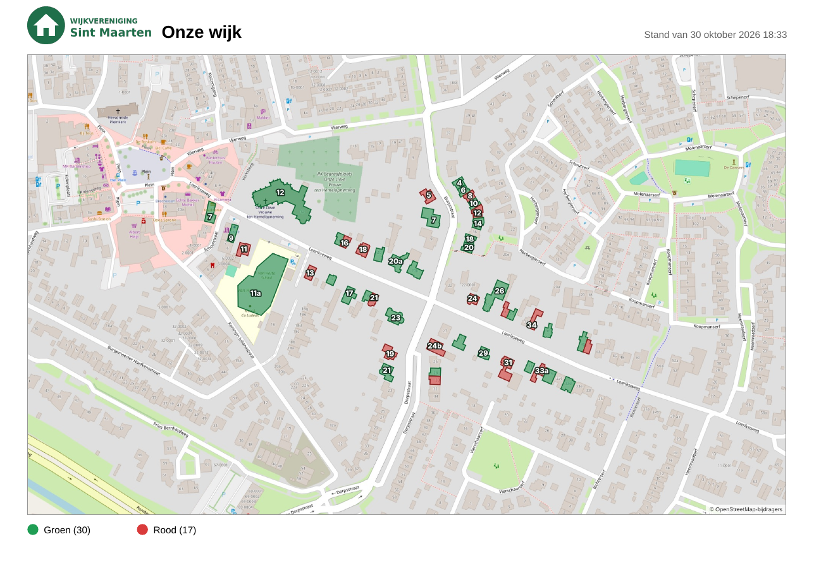</a><br><sub>PDF: kaart met legenda en aantallen</sub></td><td align="center" valign="top"><a href="docs/screenshots/pdf-toelichting.png">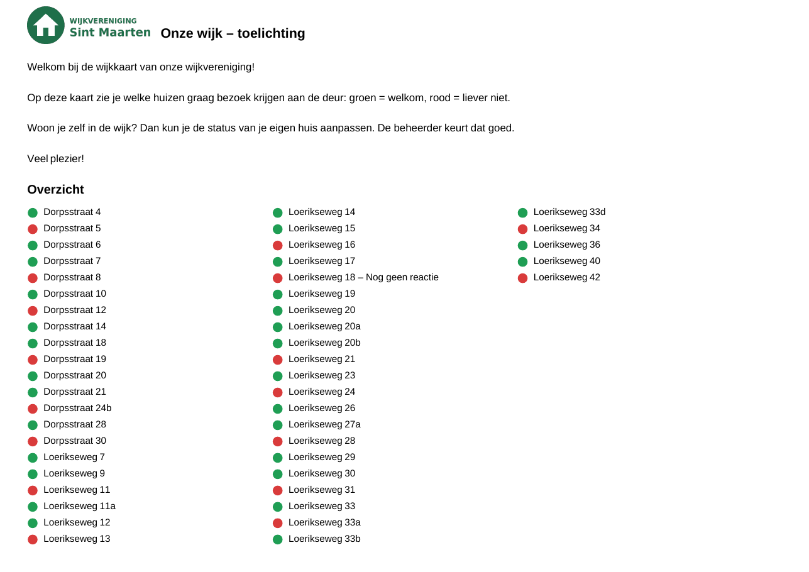</a><br><sub>PDF: logo, uitleg en overzicht</sub></td></tr>
</table>

## Bewoners: Mijn huis
- In de **geïnstalleerde app** (PWA) staat in de menubalk altijd een knop **Mijn huis**, plus een knop **Sync** (🔄) waarmee je de huizen direct bijwerkt (de app ververst ook zelf elke 30 seconden).
- In een **gewone browser** staat bovenin een schakelaar **Bewerken** (✏️). Die staat **standaard aan** (zet je hem uit, dan onthoudt de browser dat), zodat de knop *Mijn huis* in de menubalk staat; zet je hem uit, dan verdwijnt die knop. *PDF opslaan* en *PDF bekijken* staan onder het menu **Meer** (⋯), ook in de app. Het balkje met de statuskleuren zweeft op een klein scherm altijd net boven de menubalk. In de app is deze schakelaar verborgen.

<table>
<tr><td align="center" valign="top"><a href="docs/screenshots/bewerken-meer-mobiel.png">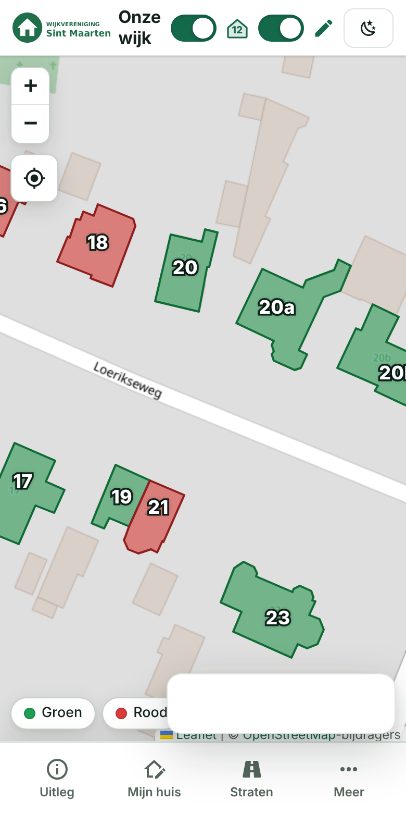</a><br><sub>Menu Meer</sub></td><td align="center" valign="top"><a href="docs/screenshots/bewoner-kies-huis.png">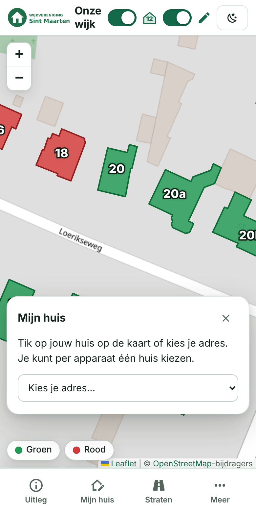</a><br><sub>Huis kiezen</sub></td><td align="center" valign="top"><a href="docs/screenshots/bewoner-wacht.png">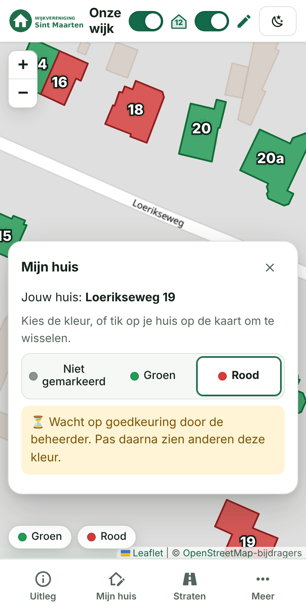</a><br><sub>Wacht op goedkeuring</sub></td><td align="center" valign="top"><a href="docs/screenshots/bewoner-heropend.png">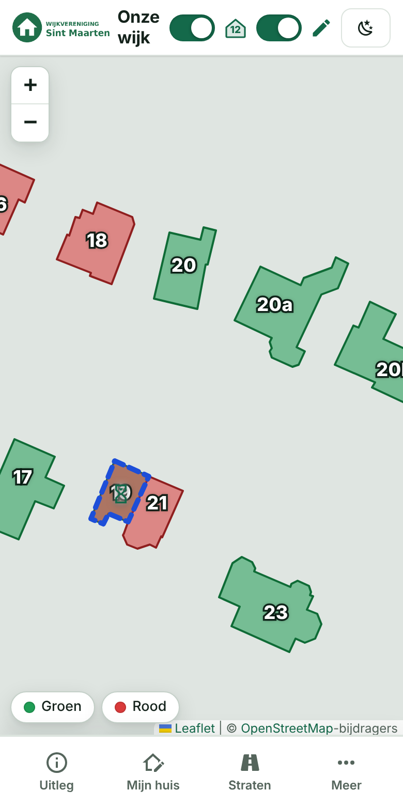</a><br><sub>App heropend: koppeling blijft</sub></td></tr>
</table>

**Snel naar jouw huis** – met een muis dubbelklik je op een huis, op een touchscreen druk je er lang op (ruim een halve seconde). Dan gaat *Bewerken* aan (in de browser), springt de kaart naar het huis en start de wijzigmodus; heb je nog geen huis gekozen, dan vraagt de app of het jouw huis is. Een dubbelklik buiten de huizen zoomt gewoon in. In het beheer selecteert hetzelfde gebaar het huis in de selecteermodus.

**Mijn locatie** – onder de zoomknoppen staat de knop *Mijn locatie* (het richtkruis). De locatie staat **standaard aan**: bij het openen van de kaart vraagt de browser om toestemming (nadat de uitleg is gesloten). Bij het eerste bezoek komt eerst de uitleg en daarna de locatievraag. Geef je die, dan schakelt de knop in (blauw), verschijnt je positie als blauwe stip met een lichte cirkel voor de nauwkeurigheid, zoomt de kaart naar je toe en volgt hij je terwijl je loopt. Zonder toestemming blijft de kaart zoals hij was en volgt er geen melding. Schuif je de kaart zelf weg, dan stopt het volgen (de stip blijft) en brengt een tik op de knop je terug; nog een tik op de volgende stand zet de locatie uit. Wie de locatie zelf uitzet, krijgt hem op dat apparaat niet meer vanzelf aan (alleen die keuze wordt onthouden, in de browser); een tik op de knop zet hem weer aan. Zolang de locatie aan staat blijft het scherm aan, en dus ook zolang je je positie met de Community deelt, zodat je de telefoon tijdens het lopen niet steeds hoeft te ontgrendelen (als je browser dat ondersteunt; anders dimt het scherm gewoon). Trekt de browser dat in, bijvoorbeeld bij batterijbesparing, of ga je even naar een andere app, dan wordt het scherm bij terugkomen en zodra het kan opnieuw aangehouden. Staat de locatie geblokkeerd, dan opent een tik op *Mijn locatie* of op de Community-knop een kort venster met uitleg om dat op iOS (Safari) en Android (Chrome) weer toe te staan. Je positie blijft op je telefoon: ze wordt nergens opgeslagen of verstuurd, behalve als je zelf kiest voor delen met de Community (zie hieronder). Het tonen van je locatie werkt alleen via **https**. De beheerder kan de knop, en daarmee de locatie, verbergen (zie *Config*).

<table>
<tr><td align="center" valign="top"><a href="docs/screenshots/mijn-locatie-mobiel.png">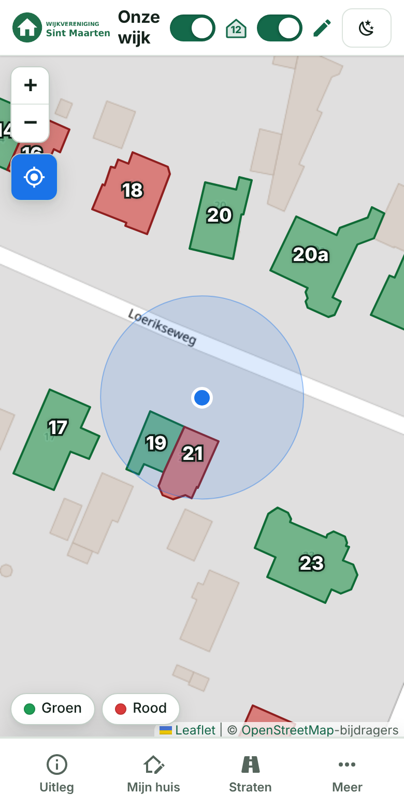</a><br><sub>Mijn locatie: blauwe stip met nauwkeurigheidscirkel</sub></td></tr>
</table>

**Community** – optioneel, standaard **uit**; de beheerder zet het aan onder *Instellingen → Config → Weergave → Community*. Dan verschijnt onder *Mijn locatie* een tweede knop (de drie poppetjes) om je positie live te delen. Delen is altijd vrijwillig: je moet het eerst bevestigen en stoppen kan met één tik. Wie meedoet ziet de andere deelnemers als **stippen** (met het aantal op de knop); wie niet deelt, ziet niemand. Er staat geen naam bij. In het bevestigingsvenster kiest een deelnemer ook een **kleur en een symbool** (bijvoorbeeld een dier) waarmee anderen hem zien; zonder keuze is het de standaard paarse stip. De beheerder zet die keuze uit met *Kleur en symbool kiezen* (standaard aan), dan zijn alle stippen paars. De **titel en de tekst** van het bevestigingsvenster stelt de beheerder in onder *Config → Teksten* (per taal; leeg = standaardtekst). De server bewaart posities alleen kort in het geheugen (niet op schijf) en wist ze zodra iemand stopt, de pagina sluit, of na 45 seconden zonder signaal; de beheerder zet de functie uit en alle posities zijn direct weg. In het beheer ziet de beheerder alle deelnemers als stippen op de kaart, met het aantal in de zijbalk. Dit werkt alleen als de knop *Mijn locatie* ook aan staat.

<table>
<tr><td align="center" valign="top"><a href="docs/screenshots/community-venster-mobiel.png">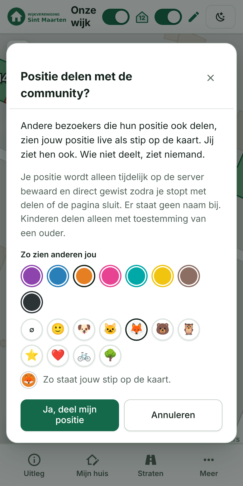</a><br><sub>Delen bevestigen, met kleur en symbool</sub></td><td align="center" valign="top"><a href="docs/screenshots/community-kaart-mobiel.png">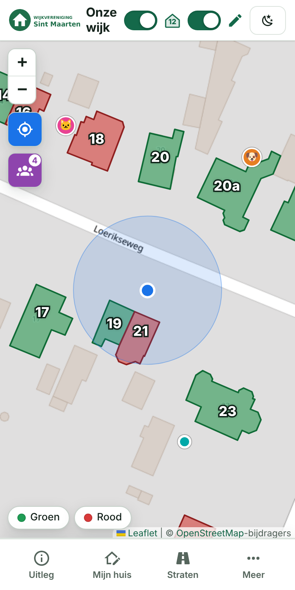</a><br><sub>Deelnemers als stippen, het aantal op de knop</sub></td><td align="center" valign="top"><a href="docs/screenshots/beheer-community.png">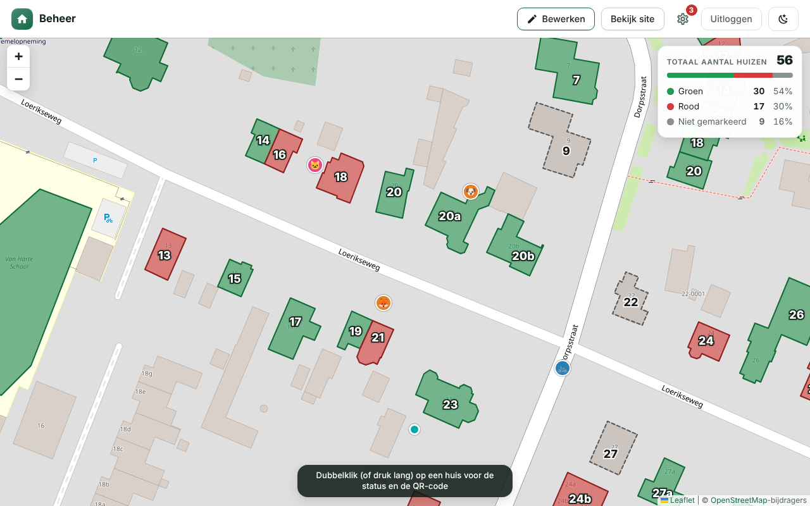</a><br><sub>Beheer: alle deelnemers op de kaart</sub></td></tr>
</table>

**In het beheer** werkt dit ook: dubbelklik (of druk lang) op een huis en de selecteermodus gaat aan met dat huis geselecteerd, ook als je net aan het tekenen was (zolang er nog geen vlak loopt).

### Toegang via QR-code (optioneel)
Wil je dat bewoners alleen hun **eigen huis** kunnen koppelen, dan zet je onder *Instellingen → Bewoners → Toegang via QR-code* de schakelaar *Huis kiezen alleen via QR-code* aan. Elk huis heeft dan een eigen QR-code met een geheim dat **niet** op de kaart staat (de huis-id's zijn openbaar, daarom is het geheim apart).
- **Uitdelen:** kies *QR-codes afdrukken (PDF)* (alle straten of één straat): een A4 met per huis een kaartje om bij de bewoners te bezorgen. De QR is één geheel: de sitetitel bovenaan en straat + huisnummer onderaan zijn in de afbeelding verwerkt, met het app-icoon in het midden van de code. Bij een geselecteerd huis in de editor staat een knop **QR-code** om de code te tonen, de **link te kopiëren**, als PNG te downloaden of te **vernieuwen**.
- **Delen via WhatsApp:** in de popup van een huis staan *Delen via WhatsApp* (en, op telefoon, het delen van het kaartje) met een voorbereide tekst. Die tekst pas je aan onder *Instellingen → Config → Teksten → Tekst bij delen via WhatsApp* (per taal; in *Bewoners → Toegang via QR-code* staat een verwijzing met de knop *Naar Config*). Het bericht en het kaartje gaan in de standaardtaal van de site; is *Meertalig* aan, dan staat in de popup een taalkiezer (met vlaggen) om ze in een andere taal te tonen en te delen, en de afdrukbare PDF volgt de standaardtaal; `{adres}` wordt het adres van het huis en `{link}` de persoonlijke link (ontbreekt `{link}`, dan komt de link achter de tekst). Leeg = standaardtekst.
- **Bewoner:** scant de code met de camera van de telefoon, bevestigt "Is dit jouw huis?" en kan daarna het huis wijzigen. In het scherm *Mijn huis* staat zonder koppeling alleen de uitleg om te scannen; de kaart en de adreslijst werken dan niet meer voor het kiezen van een huis.
- **Eén apparaat per huis:** is een huis al gekoppeld, dan weigert de server een tweede apparaat. Verwijder de koppeling (*Instellingen → Bewoners → Apparaten*) om opnieuw te kunnen scannen.
- **Al gekoppeld, of huis bezet:** scant iemand een QR met een apparaat dat al aan een huis is gekoppeld (of een huis dat al aan een ander apparaat hangt), dan verschijnt een venster om de beheerder een **kort bericht** (max. 300 tekens) te sturen, bijvoorbeeld bij een nieuwe telefoon of een verhuizing. De beheerder krijgt een pushmelding.
- **Intrekken:** *Vernieuwen* (per huis of alle huizen) maakt de oude QR-codes ongeldig.
- **Combinatie:** een geldige QR vervangt de toegangscode voor apparaten zonder GPS; de locatiecontrole en de goedkeuring door de beheerder blijven gelden. Schakel je QR-only uit, dan werkt alles weer zoals voorheen (kaart/lijst).
- **Let op:** een QR is zo veilig als de brief: wie hem fotografeert, kan hem gebruiken (daarom één apparaat per huis, vernieuwen en jouw goedkeuring). Op iPhone opent een gescande link in de browser, niet in de geïnstalleerde app; gebruik je *Alleen in de geïnstalleerde app*, dan moet de bewoner na het scannen de app openen. De geheimen staan in `data/db.json`, niet in de backups.

<table>
<tr><td align="center" valign="top"><a href="docs/screenshots/qr-instellingen.png">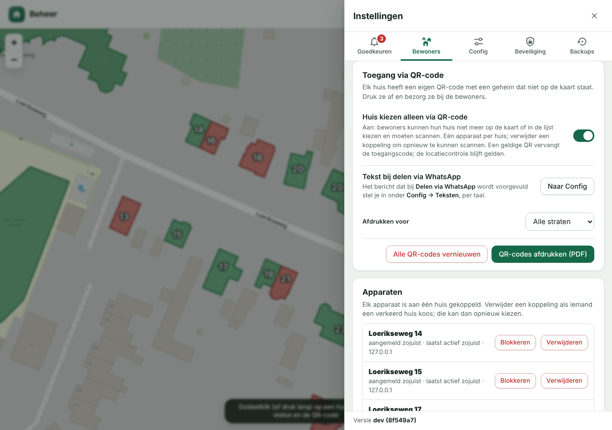</a><br><sub>Instellingen: Toegang via QR-code</sub></td><td align="center" valign="top"><a href="docs/screenshots/qr-dialoog.png">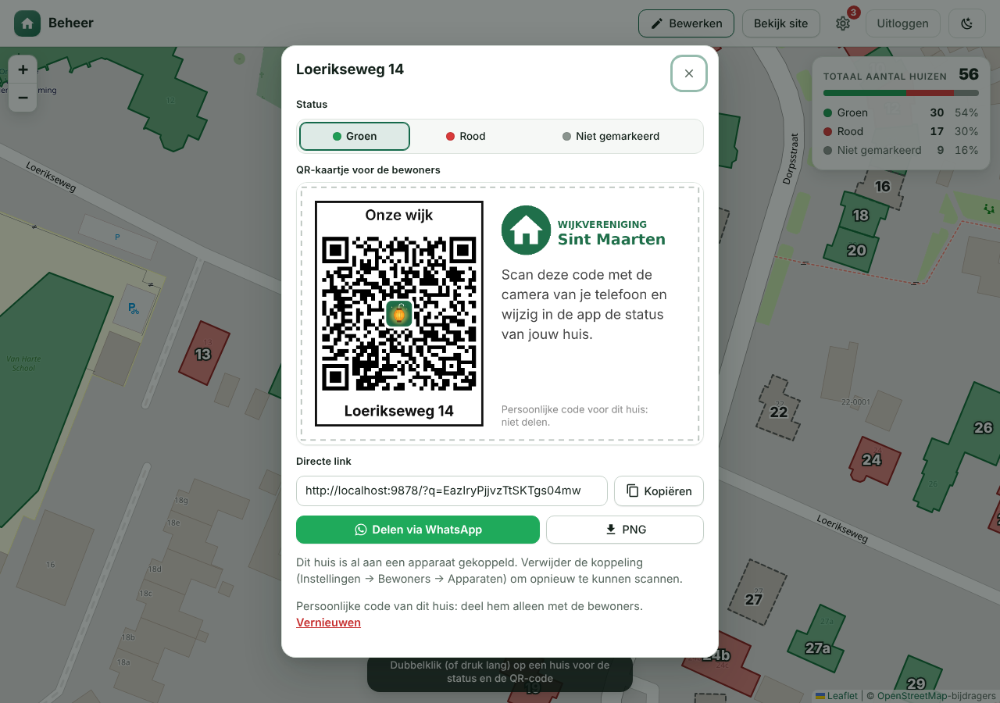</a><br><sub>QR-code van één huis</sub></td></tr>
<tr><td align="center" valign="top"><a href="docs/screenshots/qr-pdf.png">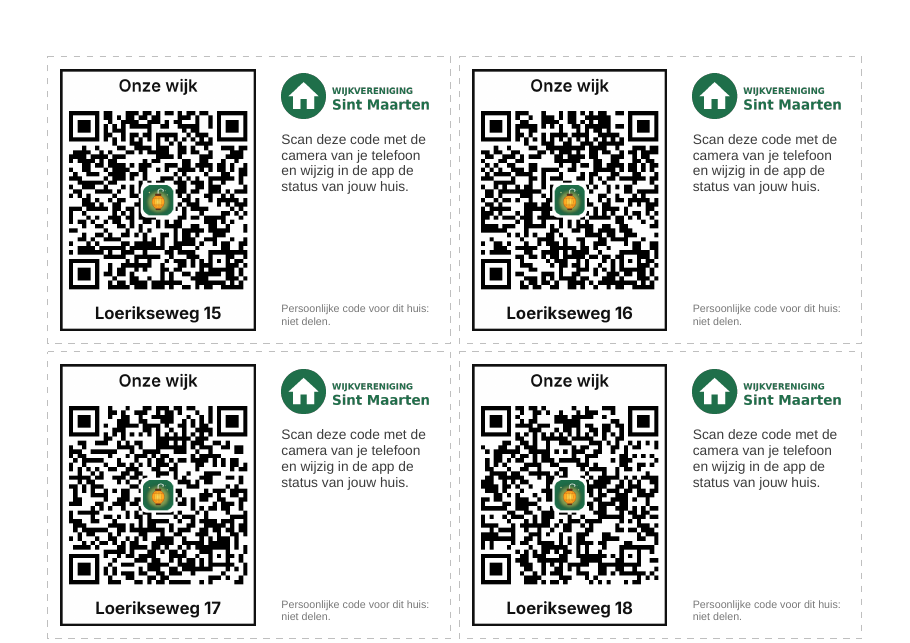</a><br><sub>Afdrukbare PDF met een kaartje per huis</sub></td><td align="center" valign="top"><table><tr><td align="center" valign="top"><a href="docs/screenshots/qr-bevestigen.png">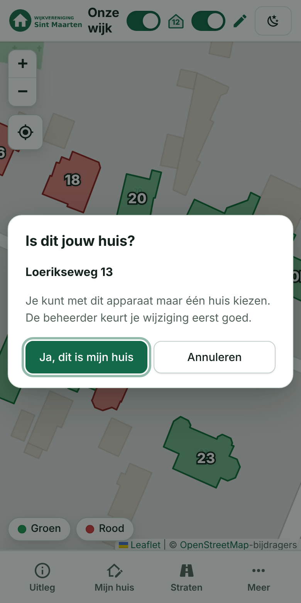</a><br><sub>Na het scannen: bevestigen</sub></td><td align="center" valign="top"><a href="docs/screenshots/qr-zonder-scan.png">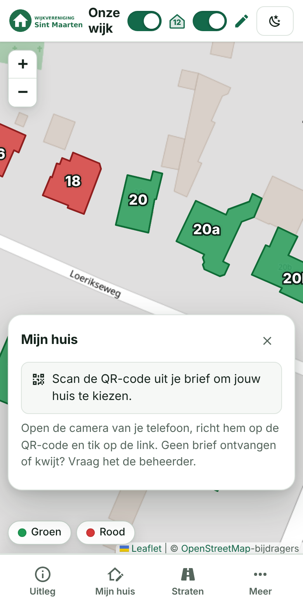</a><br><sub>Zonder QR (QR-only)</sub></td></tr></table></td></tr>
</table>

**Wijzigen plannen** – zet onder *Instellingen → Bewoners → Planning* de schakelaar *Wijzigen uitschakelen op een datum en tijd* aan en kies met de datum-/tijdkiezer wanneer. Tot dat moment kunnen bewoners wijzigen (browser én app); daarna staat het uit. De twee schakelaars eronder worden in die tijd uitgeschakeld en genegeerd; zet je de planning uit, dan gelden ze weer.

**Na de einddatum nog groen ↔ rood wisselen** – naast de planning staat de schakelaar *Na die datum mogen bewoners hun eigen huis nog wisselen tussen groen en rood*. Staat die aan, dan kunnen bewoners die al een huis hebben na de einddatum nog hun eigen huis wisselen van groen naar rood of andersom (niet van of naar *niet gemarkeerd*, en geen nieuw huis kiezen), nog steeds met jouw goedkeuring. De knop *Mijn huis* toont dan alleen nog die twee kleuren; bezoekers zonder huis zien de knop (en *Bewerken*) niet meer. Deze schakelaar gaat voor de twee schakelaars eronder en werkt alleen als de planning aan staat.

**Site sluiten** – onder *Instellingen → Bewoners → Planning → Site sluiten* zet je *Site sluiten op een datum en tijd* aan en kies je het moment, bijvoorbeeld na afloop van het evenement. Tot dat moment is de site gewoon open. Daarna zien bezoekers een **bedankscherm** in plaats van de voorpagina en is de kaart met de huizen niet meer te bekijken: de server stuurt dan ook geen huizen, kaartweergave of aantallen meer mee, dus ze zijn ook niet via de browser op te vragen. Bewoners kunnen dan geen huis meer koppelen of wijzigen en de community doet niet meer mee. Wie de pagina open had, krijgt het bedankscherm bij de eerstvolgende verversing (binnen ongeveer 30 seconden). Je ziet de kaart zelf gewoon in het beheer en kunt alles blijven aanpassen; met *Bekijk site* zie je wat bezoekers zien. Verzet je de datum naar later of zet je het uit, dan is de site meteen weer open (het gekozen moment blijft bewaard). Kies je een moment dat al voorbij is, dan sluit de site meteen; daar vraagt het beheer eerst om bevestiging. Het bedankscherm toont de naam van de site, het logo (zonder klein logo het gewone logo) en een tekst; die tekst pas je aan onder *Config → Teksten → Tekst van het bedankscherm* (per taal; er staat al een standaardtekst, met *Standaardtekst* zet je die terug). De taalkeuze en de licht/donker-knop blijven beschikbaar. Telefoons die de site als app hebben geïnstalleerd en al een tijd niet online waren, kunnen tot de eerstvolgende verbinding nog de laatst bewaarde kaart tonen.

<table>
<tr><td align="center" valign="top"><a href="docs/screenshots/instellingen-planning.png">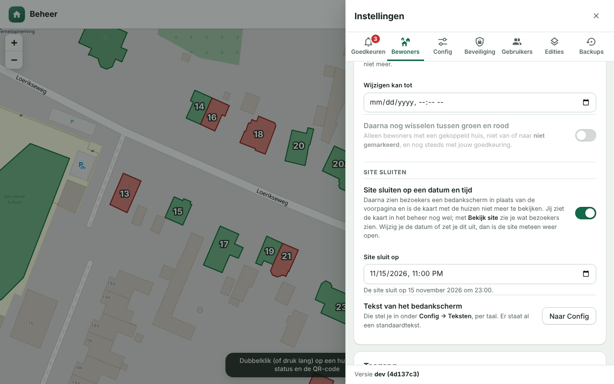</a><br><sub>Planning: site sluiten</sub></td><td align="center" valign="top"><a href="docs/screenshots/bedankscherm.png">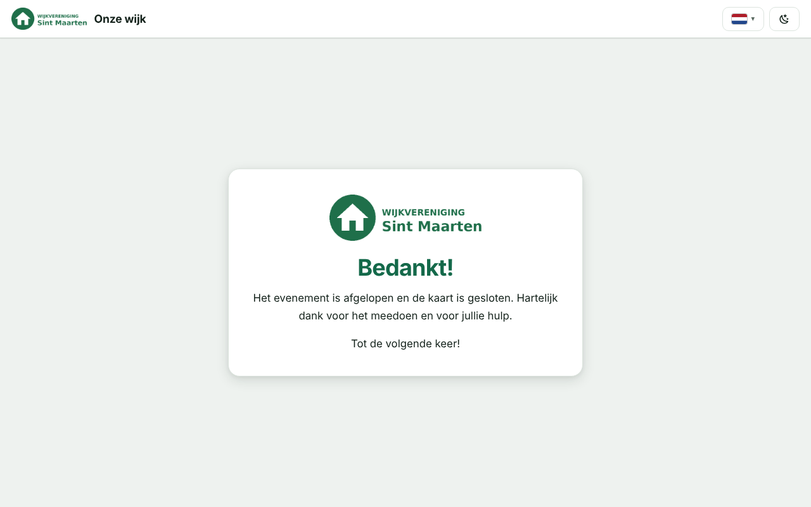</a><br><sub>Bedankscherm</sub></td><td align="center" valign="top"><a href="docs/screenshots/bedankscherm-mobiel.png">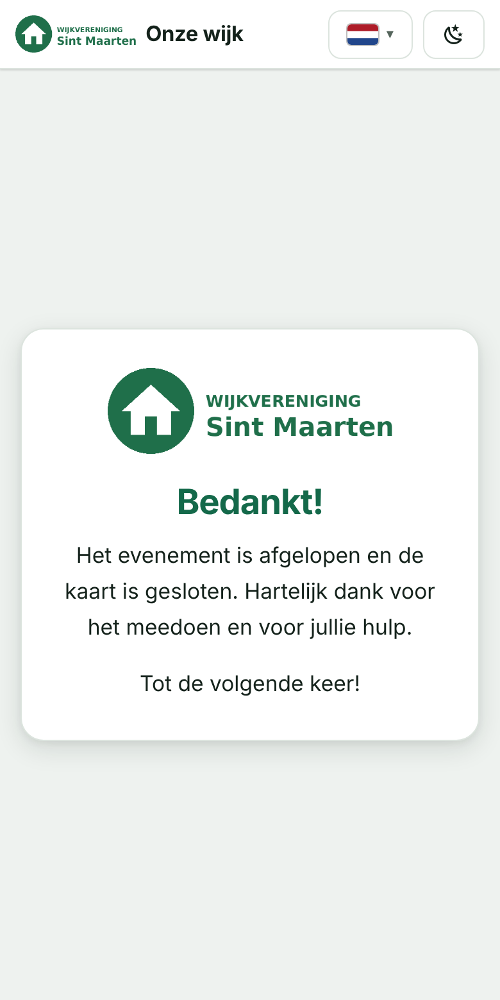</a><br><sub>Bedankscherm op een telefoon</sub></td></tr>
</table>

**Eenvoudige weergave** – onder *Instellingen → Config → Weergave* zet je *Eenvoudige weergave* aan. Op de website verdwijnen dan de schakelaars *Huisnummers* en *Bewerken* en de knop *Straten*; *Uitleg*, *Mijn huis* en *PDF opslaan* staan dan direct in de menubalk (het menu *Meer* vervalt) en Bewerken staat vast aan.

**Toegangscode voor apparaten zonder GPS (optioneel)** – onder *Instellingen → Bewoners → Toegang* stel je een code van 4 tot 6 cijfers in (of kies *Willekeurig*) en zet je de schakelaar aan. Wie dan op een laptop of desktop op *Mijn huis* drukt, krijgt eerst een veld om de code in te vullen (die deel je bijvoorbeeld in de buurtapp op WhatsApp). Het apparaat onthoudt de code (cookie, 1 jaar); wijzig je de code, dan moet iedereen hem opnieuw invullen. Telefoons en tablets met GPS hoeven niets in te vullen. Standaard staat dit uit. Foute pogingen worden per IP-adres beperkt. Het is een gebruiksbeperking, geen harde beveiliging (de code staat bij de beheerder in leesbare vorm, en het apparaattype komt van de browser).

**Geofence (optioneel)** – onder *Instellingen → Bewoners → Toegang* zet je de schakelaar *Alleen in de wijk (locatie)* aan en kies je een straal (50–5000 m, standaard 500). Het midden is het midden van de kaartweergave (of anders van de huizen). De controle geldt **alleen voor telefoons en tablets met GPS**; laptops en desktops (zonder GPS) worden niet beperkt en kunnen gewoon wijzigen. Bij het openen van de wijzigmodus en bij elke wijziging vraagt de browser om de locatie; staat die buiten de straal, is hij minder nauwkeurig dan 200 m, uit of niet toegestaan, dan kan er niet worden gewijzigd en volgt een duidelijke melding. De kaart bekijken kan overal. Vereist HTTPS. De locatie komt van het apparaat zelf en de server kan die niet controleren: het is een gebruiksbeperking, geen harde beveiliging.

**Infovlak** – onder *Instellingen → Config → Teksten* staat een apart tekstveld voor het infovlak. Dat staat als opvallend groen blok bovenaan de uitleg op de website en legt uit dat bewoners hun eigen huis kunnen wijzigen. Het verdwijnt vanzelf zodra wijzigen door bewoners uit staat (of de geplande datum is verstreken).

**Misbruik tegengaan** – onder *Instellingen → Goedkeuren* en *Bewoners → Apparaten* staat bij elke openstaande wijziging en bij elk aangemeld apparaat een knop **Blokkeren**. Het apparaat verliest zijn koppeling en openstaande wijzigingen, en kan niet meer wijzigen of een huis kiezen. Je kunt er ook het **IP-adres** bij blokkeren (let op: huisgenoten of buren achter dezelfde router delen vaak een IP). Onder *Geblokkeerd* haal je een blokkade weer weg.

**Alleen in de app toestaan** – onder *Instellingen → Bewoners* zet je **Alleen in de geïnstalleerde app** aan. De schakelaar *Bewerken* verdwijnt dan voor browserbezoekers (ook bij een open pagina, na het verversen), en de server weigert wijzigingen die niet vanuit de app komen. De app meldt zich daarvoor met een kop (`X-App-Mode: standalone`). Dat is een gebruiksbeperking: wie de verzoeken zelf nabootst kan de kop meesturen, maar elke wijziging moet nog steeds door de beheerder worden goedgekeurd.

- Een bewoner tikt op zijn huis (of kiest zijn adres) en bevestigt dat. Dat apparaat is dan aan **één huis** gekoppeld (cookie, 1 jaar). Een enkele tik op het eigen huis doet niets bijzonders (net als bij elk huis een popup); wijzigen begint pas met **dubbelklikken of lang indrukken** (of *Mijn huis*). Daarna wisselt elke tik op dat huis (of een keuze in het venster) de kleur: niet gemarkeerd → groen → rood → niet gemarkeerd. Andere huizen kunnen niet worden gewijzigd.
- De wijziging is **pas zichtbaar voor anderen nadat de beheerder die goedkeurt**. De bewoner ziet het huis in de tussentijd met een gestippelde rand en de melding *Wacht op goedkeuring*; na de beslissing volgt een bericht (goedgekeurd of niet doorgevoerd). De beheerder kan de status van een huis altijd zelf aanpassen; een openstaand voorstel volgt dan de nieuwe status of vervalt als het precies overeenkomt.
- Er worden alleen een willekeurig apparaat-token (als hash), het IP-adres van het laatste verzoek (voor het blokkeren) en het gekozen huis bewaard, geen namen of andere persoonsgegevens.
- De koppeling en het voorstel blijven **bewaard na het afsluiten van de app**: ze staan op de server, met een lokale kopie van het token als reserve (voor als de cookie wordt gewist) en van de laatste status (voor als er geen verbinding is). Het eigen huis blijft ook buiten de wijzigmodus zichtbaar (⏳ zolang de wijziging op goedkeuring wacht, daarna 🏠).
- De app **ververst zichzelf** (elke 30 seconden, en zodra je terugkeert naar de app of weer online bent). Keurt de beheerder een wijziging goed, dan verschijnt die vanzelf op het apparaat, inclusief een melding "Je wijziging is goedgekeurd".

## Talen en donkere weergave
- **Standaardtaal** – onder *Instellingen → Config → Taal* kies je met een uitklapmenu (met vlaggen) de standaardtaal: 🇳🇱 Nederlands of 🇬🇧 English. Die taal geldt voor de site, de app, de PDF's, het beheer en de pushmeldingen aan de beheerder, **ook als meertalig uit staat**.
- **Meertalig** – met de schakelaar *Meertalig* (standaard uit) verschijnt rechtsboven in de menubalk een vlag met een uitklapmenu met de ondersteunde talen. De keuze van een bezoeker wordt onthouden in zijn browser en geldt voor die bezoeker (het beheer volgt dezelfde keuze). Staat de schakelaar uit, dan krijgt iedereen de standaardtaal.
- **Teksten per taal** – is *Meertalig* aan, dan staat onder het taalblokje in *Config* een **taalbalk met vlaggen**. De velden eronder zijn per taal: kies een vlag en je bewerkt de naam van de site en de app, de korte naam, de namen van de statussen, het infovlak, de uitleg en de tekst bij delen via WhatsApp voor die taal; een vlaggetje bij het veld toont voor welke taal het geldt. Wat je intikt blijft bij het wisselen van taal bewaard tot je op *Opslaan* drukt. Een leeg veld in een andere taal valt terug op de Nederlandse tekst (het standaard-infovlak en de standaard-WhatsApptekst worden automatisch vertaald); het Nederlands blijft de bron. Is *Meertalig* uit, dan bewerk je de velden van de standaardtaal. Het logo en de overige instellingen gelden voor alle talen. In de Engelse weergave heet *Sint Maarten* overal *Halloween*.
- **Donker/licht** – naast de vlag staat een knop (maan/zon) waarmee elke bezoeker wisselt tussen de lichte en de donkere weergave. Standaard volgt de site de instelling van het apparaat; de keuze wordt onthouden. In de donkere weergave **keert het logo automatisch om** (zwart wordt wit) en wordt de kaart wat gedimd. De knop staat altijd in beeld, ook als meertalig uit staat.
- **Vertalingen toevoegen** – de bron van alle teksten is Nederlands; een woordenboek per taal (`public/js/lang-en.js`, sleutel = Nederlandse tekst, waarde = vertaling; `{naam}` is een variabele) vertaalt de pagina in de browser en de pushmeldingen op de server. De tests (`npm test`) controleren dat elke vertaling dezelfde variabelen heeft.

<table>
<tr><td align="center" valign="top"><a href="docs/screenshots/instellingen-config-talen.png">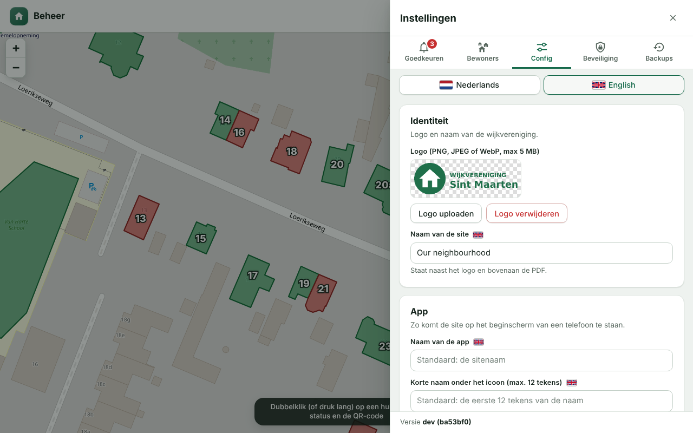</a><br><sub>Config: taalbalk met vlaggen</sub></td><td align="center" valign="top"><a href="docs/screenshots/publiek-engels-taalmenu.png">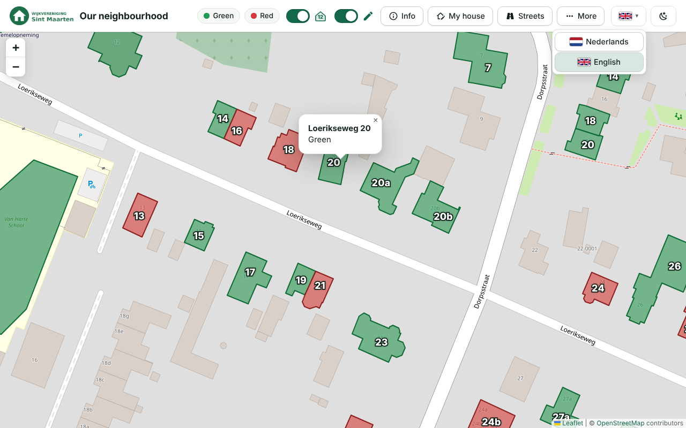</a><br><sub>Engelse site met taalmenu</sub></td><td align="center" valign="top"><a href="docs/screenshots/mobiel-engels-donker.png">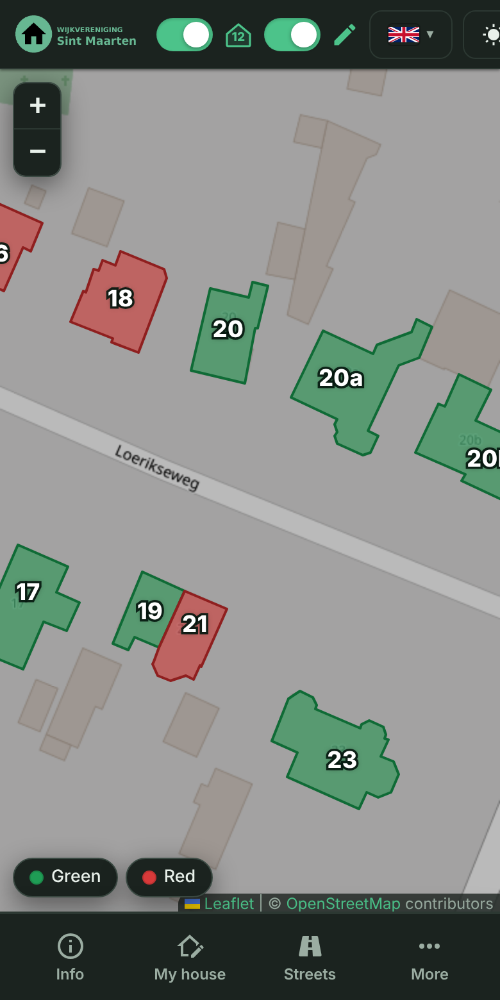</a><br><sub>Mobiel: Engels en donker</sub></td></tr>
</table>

## Het beheer (`/beheer`)

<table>
<tr><td align="center" valign="top"><a href="docs/screenshots/onboarding.png">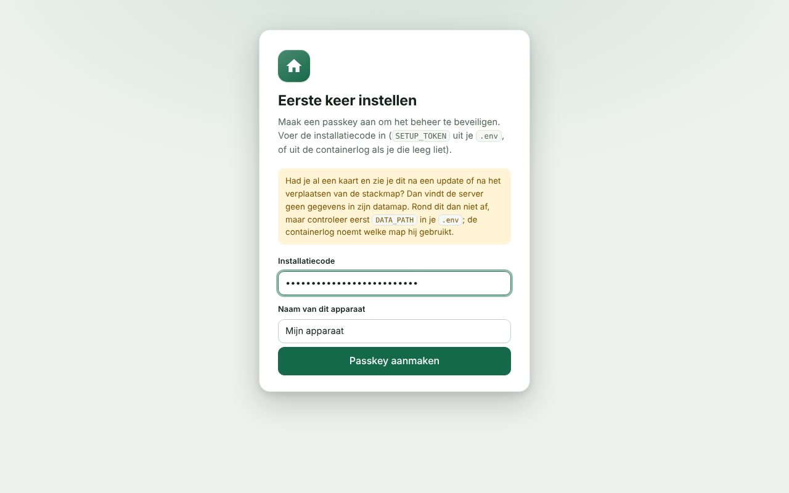</a><br><sub>Onboarding met installatiecode</sub></td><td align="center" valign="top"><a href="docs/screenshots/beheer-login.png">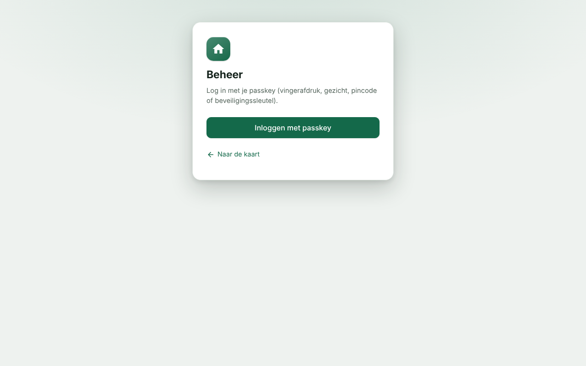</a><br><sub>Inloggen met passkey</sub></td></tr>
<tr><td align="center" valign="top"><a href="docs/screenshots/beheer-tekenen.png">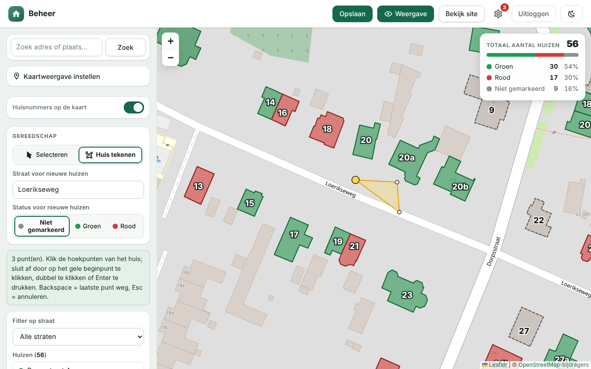</a><br><sub>Huis tekenen</sub></td><td align="center" valign="top"><a href="docs/screenshots/beheer.png">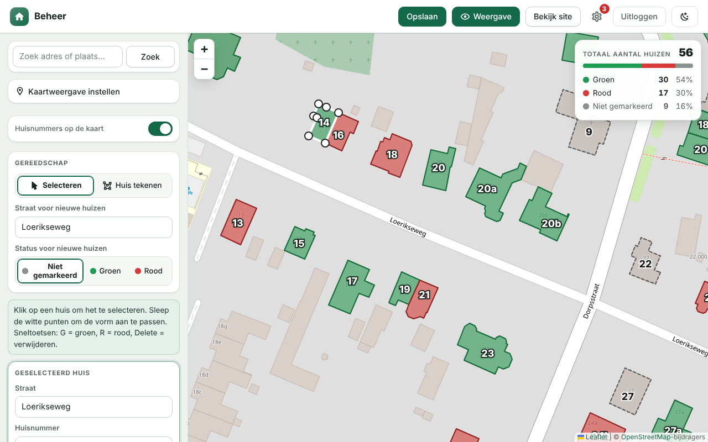</a><br><sub>Huis bewerken</sub></td></tr>
</table>

**Onboarding** – de eerste keer kies je met de installatiecode (`SETUP_TOKEN`) een gebruikersnaam en hoe je inlogt: met een **passkey** of met een **wachtwoord** (daarna kun je meteen tweestapsverificatie aanzetten, of later). Kan een passkey hier niet (geen HTTPS of geen echte domeinnaam), dan legt de wizard uit waarom en kies je het wachtwoord.

**Inloggen** – met passkey (vingerafdruk, gezicht, pincode of beveiligingssleutel) of met gebruikersnaam en wachtwoord, en zo nodig de code uit je authenticator-app. Zie [Inloggen](#inloggen-passkey-wachtwoord-en-mfa).

**Weergave en bewerken** – het beheer opent in de **weergave**: alleen de kaart, zonder zijbalk. Dubbelklik (of druk lang op een touchscreen) op een huis voor een **popup** waarmee je het huis direct **groen, rood of niet gemarkeerd** maakt (het wordt meteen opgeslagen) en waarin het **QR-kaartje** voor de bewoners staat: met logo, adres, QR en uitleg. Daaronder staat de **directe link** met een kopieerknop, een knop **Delen via WhatsApp** (opent WhatsApp met een kant-en-klaar bericht en de link), op telefoons ook **Kaartje delen…** (het plaatje via het deelmenu), een **PNG** om te downloaden en *Vernieuwen*. Met **✏️ Bewerken** open je het bewerkscherm (huizen tekenen, selecteren, zoeken, kaartweergave); **✓ Weergave** brengt je terug (bij niet-opgeslagen wijzigingen vraagt het eerst).

**Onderbalk** – op een telefoon en in de geïnstalleerde beheer-app staat onderaan een balk met **Bewerken** en **Instellingen** (met een badge voor wachtende meldingen); op een laptop staan die knoppen in de kopbalk.

<table>
<tr><td align="center" valign="top"><a href="docs/screenshots/beheer-huis-popup.png">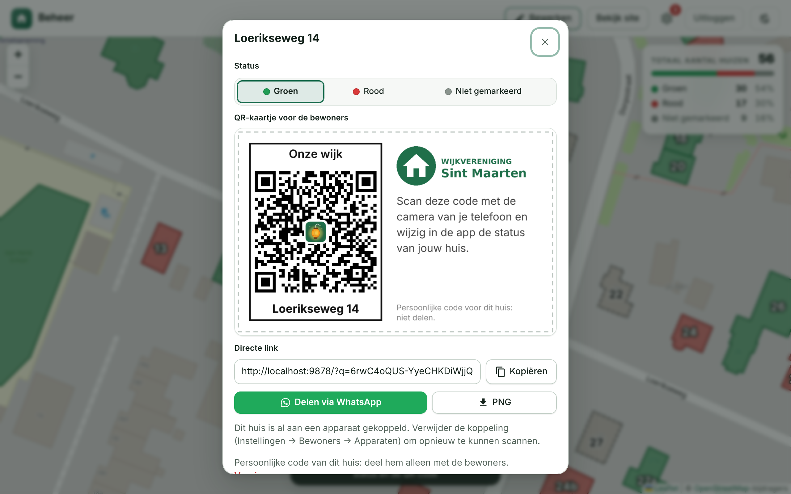</a><br><sub>Popup op een laptop</sub></td><td align="center" valign="top"><a href="docs/screenshots/beheer-weergave-mobiel.png">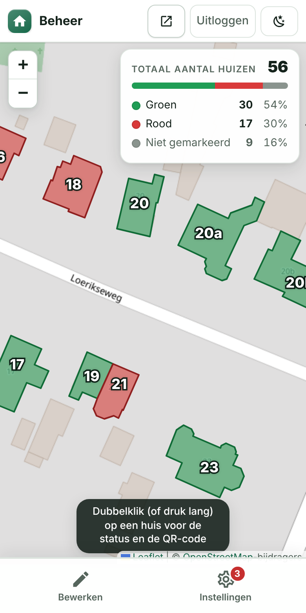</a><br><sub>Weergave met onderbalk</sub></td><td align="center" valign="top"><a href="docs/screenshots/beheer-huis-popup-mobiel.png">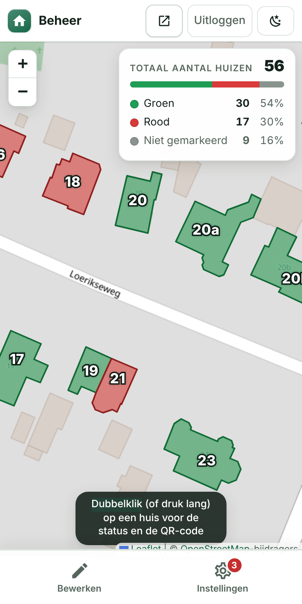</a><br><sub>Popup op een telefoon</sub></td></tr>
</table>

**Huis tekenen** – kies een kleur en klik de hoekpunten van het huis; sluit af met het gele beginpunt, dubbelklik of Enter. Nieuwe huizen krijgen standaard *geen status* en de actieve straat.

**Huis bewerken** (in het bewerkscherm) – selecteer een huis (klik, dubbelklik of lang indrukken) om de kleur, straat, huisnummer en notitie aan te passen, of sleep de hoekpunten. Sneltoetsen: **G** groen, **R** rood, **Delete** verwijderen, **Ctrl+S** opslaan. De lijst links heeft een filter per straat; de rest wordt op de kaart gedimd.

## Instellingen
Het tandwiel (⚙) in de balk schuift het instellingen-menu in beeld. Het is ingedeeld in zeven tabs (*Goedkeuren*, *Bewoners*, *Config*, *Beveiliging*, *Gebruikers* (alleen voor de eigenaar), *Edities* en *Backups*, met iconen uit [Material Design Icons](https://pictogrammers.com/library/mdi/), Apache License 2.0); elke tab bestaat uit kaarten met duidelijke schakelaars en een korte uitleg (ook op een telefoon).

<table>
<tr><td align="center" valign="top"><a href="docs/screenshots/instellingen-goedkeuren.png">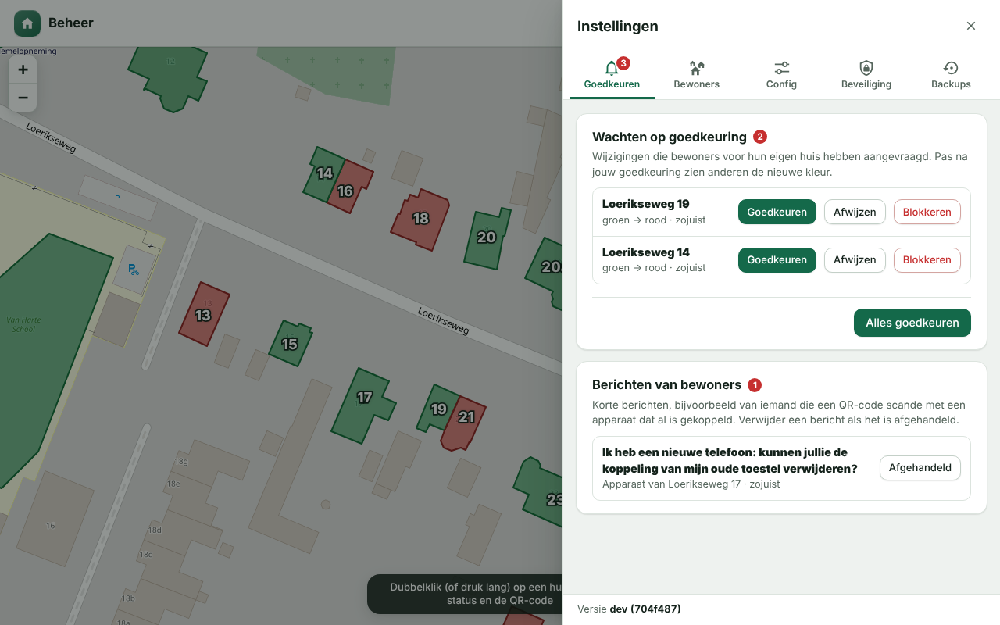</a><br><sub>Goedkeuren</sub></td><td align="center" valign="top"><a href="docs/screenshots/instellingen-bewoners.png">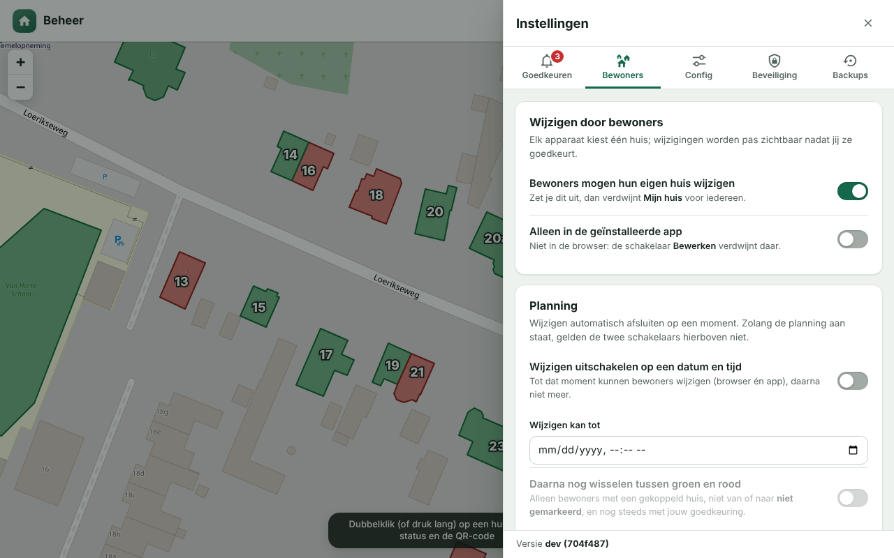</a><br><sub>Bewoners</sub></td><td align="center" valign="top"><a href="docs/screenshots/instellingen-bewoners-apparaten.png">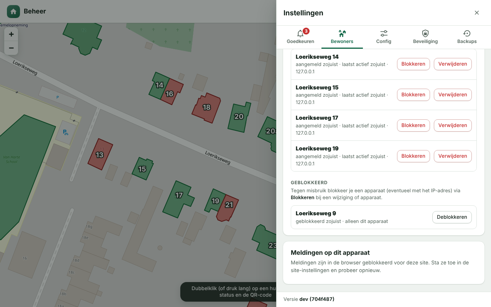</a><br><sub>Bewoners: apparaten en meldingen</sub></td></tr>
<tr><td align="center" valign="top"><a href="docs/screenshots/instellingen-config.png">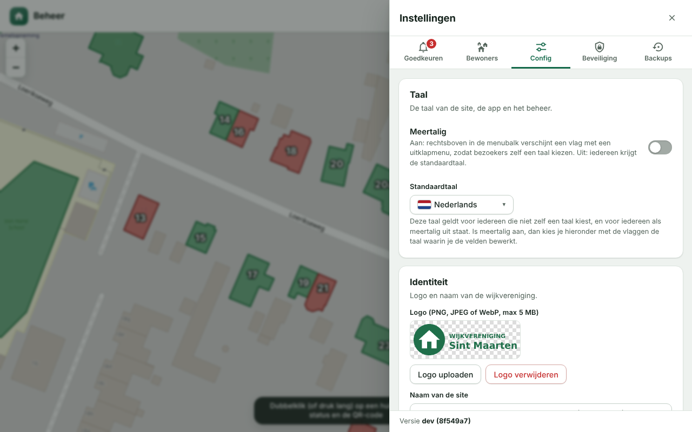</a><br><sub>Config</sub></td><td align="center" valign="top"><a href="docs/screenshots/instellingen-beveiliging.png">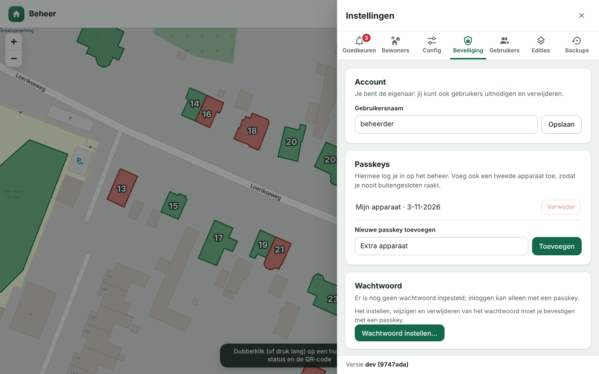</a><br><sub>Beveiliging</sub></td><td align="center" valign="top"><a href="docs/screenshots/instellingen-backups.png">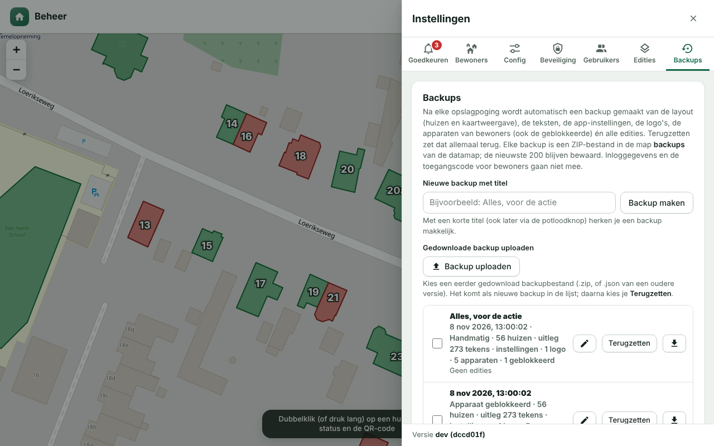</a><br><sub>Backups</sub></td></tr>
<tr><td align="center" valign="top"><a href="docs/screenshots/instellingen-gebruikers.png">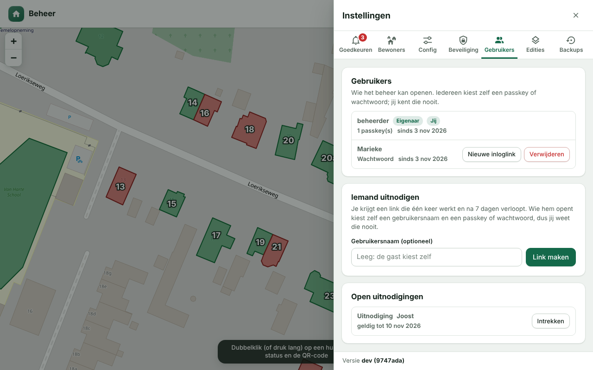</a><br><sub>Gebruikers</sub></td></tr>
</table>

<p align="center"><a href="docs/screenshots/instellingen-mobiel.png">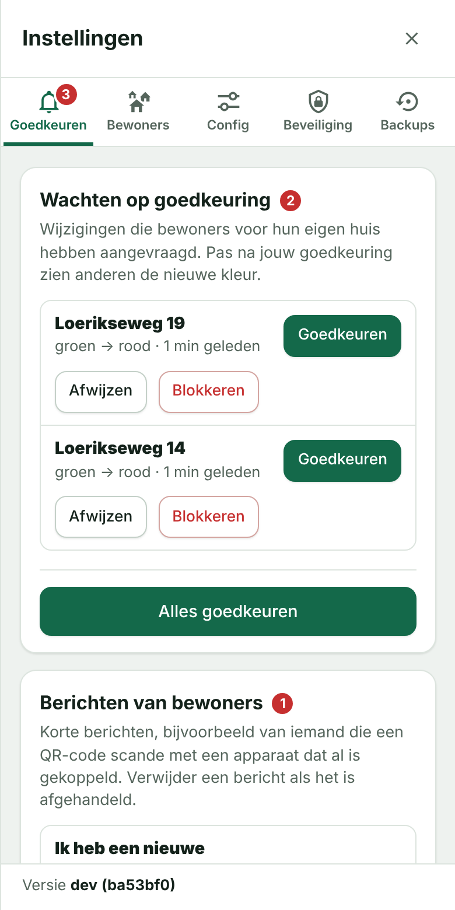</a><br><sub>Instellingen op een telefoon</sub></p>

**Goedkeuren** – de wijzigingen die bewoners voor hun eigen huis hebben aangevraagd en de **berichten van bewoners**. Rode **badges** met het aantal staan bij het tandwiel, bij de tab en bij elke lijst, in de paginatitel en – in het geïnstalleerde beheer – op het **app-icoon**; ze worden ook bijgewerkt door een pushmelding als de app dicht is. Keur wijzigingen goed of af (of alles tegelijk) en klik *Afgehandeld* bij een bericht om het te verwijderen.

**Bewoners** – alles rond het wijzigen door bewoners:
- *Wijzigen door bewoners*: aan/uit, en eventueel alleen in de geïnstalleerde app (de schakelaar *Bewerken* verdwijnt dan in de browser en de server weigert wijzigingen zonder de app-kop `X-App-Mode: standalone`).
- *Planning*: wijzigen automatisch afsluiten op een datum en tijd (met datumkiezer), met eventueel daarna nog groen ↔ rood wisselen, en de hele site sluiten op een datum en tijd (bedankscherm in plaats van de kaart).
- *Toegang*: alleen in de wijk (locatie/geofence) en een toegangscode voor apparaten zonder GPS.
- *Apparaten*: aangemelde apparaten, **alfabetisch** op straat en huisnummer (handig zoeken bij veel huizen), met koppeling verwijderen of **blokkeren** (eventueel met IP-adres), en de lijst *Geblokkeerd*.
- *Meldingen op dit apparaat*: pushmeldingen voor nieuwe wijzigingen.

**Config** – taal (meertalig en standaardtaal), logo, naam van de site en de app, de eenvoudige weergave, de knop *Mijn locatie* voor bezoekers (aan of uit; standaard aan), de *Community* (live deelnemers; standaard uit), *Kleur en symbool kiezen* voor de community (aan of uit; standaard aan), de namen van de statussen, het infovlak, de uitleg, de tekst bij delen via WhatsApp en de titel en tekst van het communityvenster en de tekst van het bedankscherm (de teksten per taal).

<table>
<tr><td align="center" valign="top"><a href="docs/screenshots/instellingen-config-afbeeldingen.png">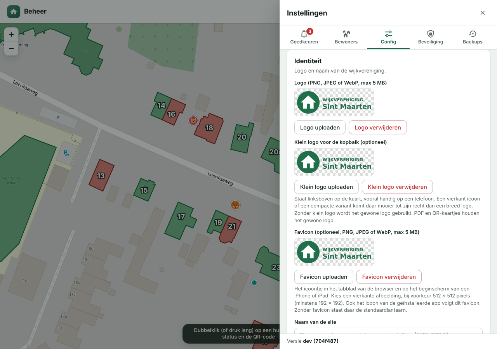</a><br><sub>Config: logo, klein logo en favicon</sub></td><td align="center" valign="top"><a href="docs/screenshots/instellingen-config-locatie.png">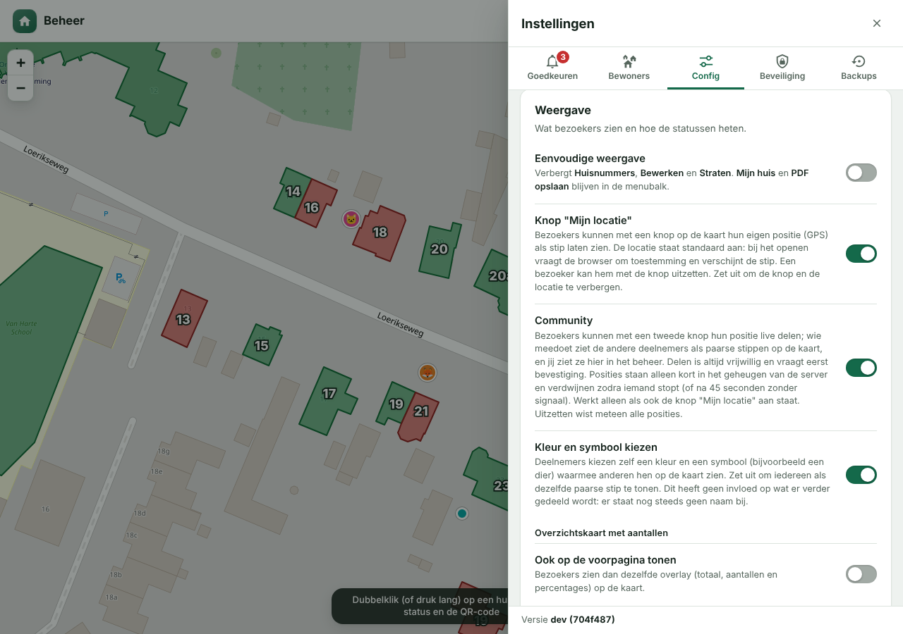</a><br><sub>Config: Mijn locatie en Community</sub></td><td align="center" valign="top"><a href="docs/screenshots/instellingen-config-communityteksten.png">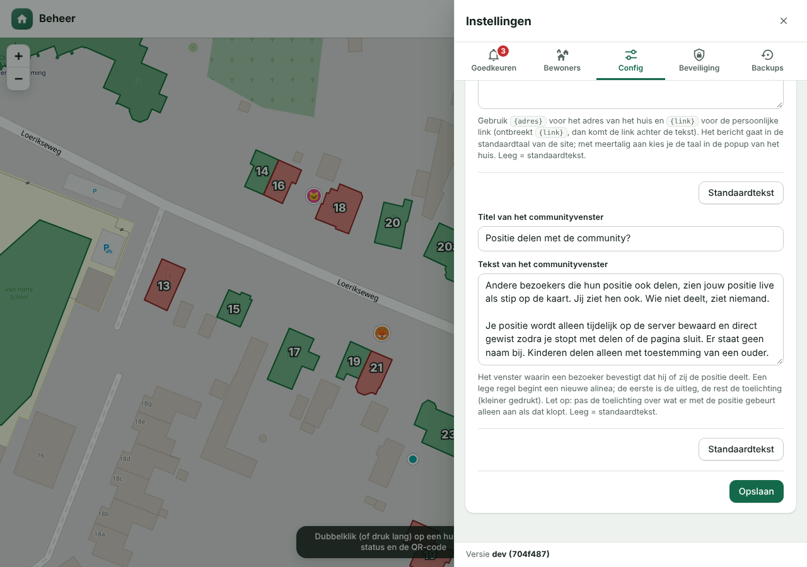</a><br><sub>Config: titel en tekst van het communityvenster</sub></td></tr>
</table>

**Beveiliging** – je eigen inlog: gebruikersnaam, passkeys, wachtwoord en tweestapsverificatie (MFA) met herstelcodes. Zie [Inloggen](#inloggen-passkey-wachtwoord-en-mfa).

**Gebruikers** (alleen de eigenaar) – wie het beheer kan openen en hoe ieder inlogt, uitnodigingslinks maken en intrekken, een nieuwe inloglink voor wie buitengesloten is, en gebruikers verwijderen. Zie [Meer beheerders uitnodigen](#meer-beheerders-uitnodigen).

**Edities** – een editie aanmaken met naam en jaartal (kopie van de live kaart of van een andere editie), de aantallen per editie, een editie bekijken of bewerken, naam of jaartal wijzigen en verwijderen. Zie [Edities](#edities-eerdere-keren-vergelijken).

**Backups** – na elke opslagpoging wordt automatisch een backup gemaakt van de layout, de teksten, de app-instellingen, de logo's, de apparaten van bewoners (ook de geblokkeerde) en alle edities; bij elke backup staat wat erin zit, en terugzetten zet dat allemaal terug. Geef een backup een **korte titel** (✎, max. 40 tekens, bijvoorbeeld "Alles" of "Alleen layout") of maak er zelf een met *Backup maken*. Terugzetten of downloaden kan altijd; verwijderen (één of meer tegelijk) moet je bevestigen met je passkey (zonder passkey: met je wachtwoord en eventueel een MFA-code).

**Versie** – onderin het menu staat de versie en commit van de draaiende build (zie [Versienummer](#versienummer)).

### Pushmeldingen voor de beheerder
- Zet in *Instellingen → Bewoners → Meldingen op dit apparaat* meldingen aan op je eigen telefoon of computer. De server maakt daarvoor zelf de (VAPID-)sleutels en bewaart ze in `data/db.json`.
- Bij een nieuwe wijziging ontvang je een pushmelding (meerdere wijzigingen kort na elkaar worden samengevoegd). Tik je erop, dan opent het beheer bij *Wijzigingen* en kun je goedkeuren of afwijzen; pas dan wordt de wijziging doorgevoerd.
- Vereist **HTTPS**. Op een iPhone/iPad werkt Web Push alleen als je het beheer eerst aan het beginscherm toevoegt (iOS 16.4 of nieuwer) en het daar opent. Een knop *Testmelding* controleert of het werkt.
- Verlopen apparaten worden automatisch opgeruimd.

## Namen van de statussen
Onder *Instellingen (⚙) → Config → Weergave* kun je de namen **Groen**, **Rood** en **Niet gemarkeerd** aanpassen, bijvoorbeeld naar *Akkoord* en *Nog niet bezocht*. De kleuren blijven groen en rood. De namen gelden overal: legenda, popups, straten-filter, de PDF, het beheer en de pushmelding. Leeg laten = standaardnaam.

## Nieuwe huizen tekenen
Een nieuw getekend huis heeft standaard **geen status** (niet gemarkeerd; kies in het beheer desgewenst een andere status voor nieuwe huizen). Het veld **Straat voor nieuwe huizen** toont de actieve of laatst gebruikte straat: die volgt het huis dat je selecteert, het straat-filter of wat je zelf invult. Nieuwe, nog lege huizen krijgen die straat vooraf ingevuld, zodat je alleen het huisnummer hoeft in te vullen.

## Huisnummers en straten
- In het beheer heeft elk huis een **straat** en een **huisnummer** (aparte velden; het straatveld stelt bestaande straten voor). Met *Filter op straat* toon je alleen de huizen van één straat in de lijst; de rest wordt op de kaart gedimd.
- De schakelaar *Huisnummers op de kaart* toont het nummer midden op elk huis (wit met donkere rand, dus goed leesbaar). Nummers die niet in het huis passen verdwijnen en komen terug bij verder inzoomen.
- In *Kaartweergave instellen* bepaal je of de nummers voor bezoekers **standaard** aan staan; bezoekers kunnen dat zelf wisselen met de schakelaar in de menubalk (de keuze wordt onthouden).
- Op de site kun je met het straat-icoon per straat de huizen verbergen of tonen. De PDF volgt die keuzes (huisnummers en zichtbare straten).
- Oudere gegevens met één veld *huisnummer/naam* worden automatisch omgezet: dat veld wordt het huisnummer.

## Hoe werkt het
- **Kaart**: OpenStreetMap (via Leaflet), geen API-sleutel nodig. Google Maps is bewust niet gebruikt: dat vereist een betaalde sleutel en de voorwaarden staan het overtekenen en exporteren naar PDF niet toe.
- **Beheer instellen**: zoek je straat en zoom ver in; stel via *Kaartweergave instellen* het midden, de startzoom en de minimale/maximale zoom in (of neem de huidige weergave over). Bezoekers openen de kaart (ook in de app) met precies die weergave; met *Automatisch* toont de site alle huizen. In dezelfde dialoog bepaal je of de huisnummers voor bezoekers standaard aan staan. Onder *Kaartvlak in de PDF* zie je met een kader op de kaart welk gebied de PDF toont (standaard automatisch alle huizen) en kun je een eigen vlak vastleggen: zet de kaart op het gewenste gebied, kies *Huidige kaart als PDF-vlak* en sla op. *Automatisch* herstelt het standaardgedrag.
- **Onboarding**: de allereerste keer vraagt `/beheer` om de `SETUP_TOKEN`, een gebruikersnaam en een passkey of wachtwoord; die eerste gebruiker is de **eigenaar**. Daarna kun je via *Instellingen* (⚙) → *Beveiliging* een extra passkey toevoegen of MFA aanzetten (doe dat zodat je niet buitengesloten raakt) en via *Gebruikers* anderen uitnodigen.

> De PDF haalt kaarttegels rechtstreeks bij OpenStreetMap op; houd het gebruik bescheiden
> ([tile usage policy](https://operations.osmfoundation.org/policies/tiles/)).

## Inloggen: passkey, wachtwoord en MFA
<table>
<tr><td align="center" valign="top"><a href="docs/screenshots/onboarding-wachtwoord.png">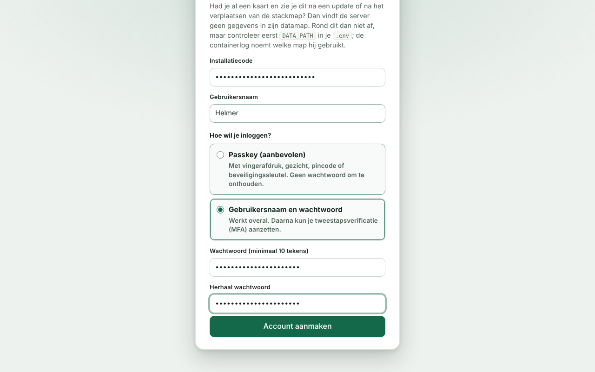</a><br><sub>Installatie met gebruikersnaam en wachtwoord</sub></td><td align="center" valign="top"><a href="docs/screenshots/mfa-instellen.png">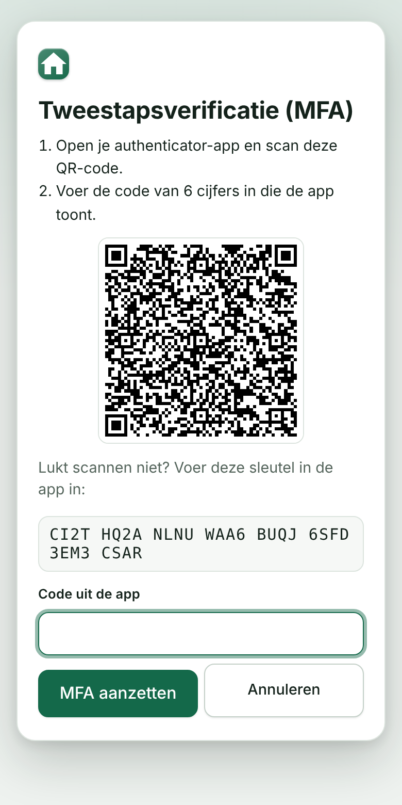</a><br><sub>MFA instellen: QR-code voor de app</sub></td><td align="center" valign="top"><a href="docs/screenshots/mfa-herstelcodes.png">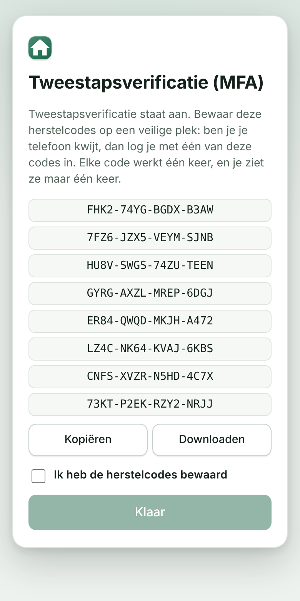</a><br><sub>Herstelcodes, één keer getoond</sub></td><td align="center" valign="top"><a href="docs/screenshots/beheer-login-mfa.png"></a><br><sub>Inloggen: de MFA-stap</sub></td></tr>
</table>

Elke gebruiker van het beheer logt in op een van deze manieren, of op allebei:
- **Passkey** (aanbevolen): vingerafdruk, gezicht, pincode of beveiligingssleutel; geen wachtwoord nodig. Werkt alleen via **HTTPS** met een echte domeinnaam (of op `localhost`). Open je het beheer via een IP-adres, een naam zonder domein (`nas`) of een naam die alleen thuis bestaat (`.local`, `.lan`), dan legt de wizard uit waarom een passkey daar niet kan.
- **Gebruikersnaam en wachtwoord**: werkt overal. Minimaal 10 tekens, minstens 4 verschillende tekens en zonder je gebruikersnaam; het wordt alleen als `scrypt`-hash opgeslagen. De gebruikersnaam is niet hoofdlettergevoelig.
- **Tweestapsverificatie (MFA)**, optioneel bij een wachtwoord: na het wachtwoord vraagt het beheer een code van 6 cijfers uit een authenticator-app (TOTP, bijvoorbeeld Microsoft Authenticator, Google Authenticator of 1Password); een code werkt één keer. Bij het aanzetten krijg je **8 herstelcodes** die je maar één keer ziet (kopiëren of downloaden); elke herstelcode werkt één keer in plaats van een code uit de app. Het MFA-geheim staat versleuteld in `db.json`; de sleutel staat in `secret.key` in dezelfde datamap, dus neem die map altijd in zijn geheel mee in je back-up.

Instellen en wijzigen doe je in *Instellingen* (⚙) → *Beveiliging*. Gevoelige acties (wachtwoord, MFA, backups of edities verwijderen) bevestig je opnieuw: met je passkey als je die hebt, anders met je huidige wachtwoord en eventueel een MFA-code. Heb je zowel een passkey als een wachtwoord, dan kan een sessie die met het wachtwoord is gestart de kaart beheren, maar je inlog niet wijzigen; daarvoor log je in met de passkey. Je laatste passkey kun je alleen verwijderen als je een wachtwoord hebt, en het wachtwoord alleen als je een passkey hebt. Een nieuw wachtwoord of MFA aan- of uitzetten meldt je op je andere apparaten af.
Mislukte pogingen (wachtwoord, MFA-code, installatiecode) worden per IP-adres en globaal beperkt.

## Meer beheerders uitnodigen
<table>
<tr><td align="center" valign="top"><a href="docs/screenshots/instellingen-gebruikers.png"></a><br><sub>Gebruikers: uitnodigen, nieuwe inloglink, verwijderen</sub></td><td align="center" valign="top"><a href="docs/screenshots/uitnodiging.png"></a><br><sub>De uitnodiging op de telefoon van de gast</sub></td></tr>
</table>

De eerste gebruiker is de **eigenaar**. Die nodigt anderen uit via *Instellingen* (⚙) → *Gebruikers* → *Iemand uitnodigen*, eventueel met een voorgestelde gebruikersnaam. Je krijgt een link (`…/beheer#invite=…`) die je **één keer te zien** krijgt, **één keer werkt** en na **7 dagen** verloopt; stuur hem zelf door (chat, mail of persoonlijk). Wie hem opent kiest zelf een gebruikersnaam en een passkey of wachtwoord (en eventueel MFA), dus de eigenaar kent niemands wachtwoord. Alleen de hash van de link wordt bewaard.
- Iedereen beheert de kaart, de bewoners, de teksten, edities en backups; alleen de eigenaar beheert gebruikers (dat dwingt de server af).
- **Nieuwe inloglink** maakt een link voor iemand die niet meer kan inloggen (telefoon kwijt, wachtwoord vergeten). De oude inlog blijft werken tot de nieuwe is ingesteld; dan vervallen de oude passkeys, het wachtwoord en MFA, en wordt die gebruiker op alle apparaten afgemeld.
- **Verwijderen** haalt de gebruiker met alle passkeys weg en beëindigt de sessies van die gebruiker. De eigenaar kan niet worden gereset of verwijderd.
- Maximaal 50 gebruikers (open uitnodigingen tellen mee). Gebruikers, uitnodigingen en inloggegevens zitten niet in de backups van het beheer.

### Niemand kan meer inloggen?
Heeft de eigenaar geen werkende passkey, wachtwoord of herstelcode meer, zet dan alle inloggegevens terug naar een nieuwe installatie. De kaart, edities, backups en instellingen blijven staan; alle gebruikers en uitnodigingen verdwijnen. Stop eerst de container, anders overschrijft de draaiende server het weer:

```bash
docker compose stop doorbell-map
docker compose run --rm doorbell-map node server/reset-login.js
docker compose up -d
```

Open daarna `/beheer`: de installatie-wizard vraagt weer om de installatiecode (`SETUP_TOKEN`). Nodig de anderen daarna opnieuw uit.

## Na een update: oude pagina's of scripts
Scripts en stijlen worden per build met `?v=<versie>-<commit>` opgevraagd en de HTML wordt nooit gecachet; zo krijg je nooit een oude `admin.js` bij nieuwe HTML (dat geeft fouten als
*Cannot set properties of null*). Zie je zo'n fout toch na een update, ververs dan hard (Ctrl+Shift+R) of wis de sitegegevens; eventueel staat een proxy/CDN (bijv. Cloudflare) te agressief te cachen.

## Releases en release notes
Bij elke geslaagde build op `main` zet de GitHub Action een tag `vMAJOR.MINOR.PATCH` (zie [Versienummer](#versienummer)) en publiceert hij ook een **GitHub Release** met officiële release notes: [alle releases](../../releases). De notes worden automatisch samengesteld uit de gemergde pull requests sinds de vorige release, ingedeeld in **✨ Nieuwe functies en verbeteringen**, **🐞 Opgeloste problemen** en **📚 Documentatie**, elk met een link naar de PR, plus het `docker pull`-commando voor die versie.
- **Indeling:** een PR uit een branch `fix/…` (of met fix/herstel/crash in de titel) telt als opgelost probleem, een branch `docs/…` als documentatie, de rest als nieuwe functie. Een duidelijke PR-titel en een korte lijst onder *Wijzigingen* in de beschrijving komen dus rechtstreeks in de release notes.
- **Handgeschreven notes:** zet je een bestand `docs/releases/vX.Y.Z.md` neer, dan gebruikt de release dat in plaats van de automatische notes (zo is [v1.0.0](docs/releases/v1.0.0.md) gemaakt).
- **Achteraf (opnieuw) maken:** Actions → *Release* → *Run workflow* en vul de tag in (bijvoorbeeld `v1.0.5`). Lokaal proberen kan met `node tools/release-notes.js vX.Y.Z` (met `GITHUB_TOKEN` en `GITHUB_REPOSITORY` gezet).

## Versienummer
Onderin het instellingenmenu (⚙) staat de versie en de commit van de draaiende build, bijvoorbeeld **v1.0.3 (9f2c4e1)**.
Bij elke geslaagde build van de GitHub Action gaat het patchnummer met 1 omhoog (de eerste build is v1.0.0); de build krijgt een git-tag `v1.0.N` en het image wordt
ook onder die tag gepubliceerd (`ghcr.io/helmerznl/doorbell-map:v1.0.3`). Het deel `1.0` komt uit het bestand `VERSION`: pas dat aan voor een nieuwe minor- of major-versie, dan begint de teller opnieuw bij 0.
Lokaal (zonder build) toont de app `dev` met de commit uit git. De workflow heeft schrijfrechten op de repo nodig om de tag te zetten (staat in `docker.yml`).

## Backups
Na **elke opslagpoging** (huizen/layout, teksten en instellingen, kaartweergave, logo's, edities, een apparaat ontkoppelen of (de)blokkeren) maakt de server een backup in de map `backups` van de datamap: `DATA_PATH/backups` (in de container `/data/backups`). Elke backup is één ZIP-bestand, `sint_maarten-backup-<id>.zip`, met:
- `backup.json`: de layout (huizen + kaartweergave), de teksten (uitleg, namen, statusnamen, infovlak, deeltekst, communityvlak, bedankscherm en de vertalingen), de **app-instellingen** (de schakelaars en keuzes uit het beheer), de **apparaten van bewoners** en de **geblokkeerde apparaten**, en **alle edities**;
- `files/`: de **logo's** (logo, klein logo en favicon) als losse afbeeldingen, zodat je er ook zonder de app een uit de ZIP kunt halen.

Niet in de backup: gebruikers, inloggegevens en uitnodigingen, de toegangscode voor bewoners, de QR-geheimen, de pushsleutels, de **IP-adressen van bewoners**, en openstaande wijzigingen en berichten van bewoners. Van een apparaat staat alleen de hash van zijn sleutel erin, zoals in de database: daarmee kom je nergens binnen, maar een apparaat dat zijn sleutel nog heeft, is na terugzetten weer gekoppeld (of geblokkeerd). Terugzetten laat het IP-adres staan dat de app nu van een apparaat of blokkade kent; een apparaat krijgt het weer bij het volgende gebruik. Backups van v2.0.0 bevatten nog IP-adressen: die wist de server bij de eerste start uit de backups in `DATA_PATH/backups` (een eerder gedownloade backup moet je zelf weggooien), en bij uploaden worden ze eruit gehaald.

Identieke staten worden niet dubbel bewaard (het laatste gebruik van een apparaat telt daarbij niet mee) en de **nieuwste 50** blijven staan; oudere worden opgeruimd, bij elke nieuwe backup en bij het starten van de server (`MAX_BACKUPS` om het aantal aan te passen). `backup.json` wordt in de ZIP gecomprimeerd; elke backup bevat de logo's opnieuw, dus reken op ongeveer 50 × (de logo's + de grootte van de live kaart per editie) aan schijfruimte.
Een gedownloade backup (.zip, downloadknop in de lijst) kun je met **Backup uploaden** weer toevoegen (maximaal 25 MB); hij komt als nieuwe backup in de lijst. De server controleert eerst het hele bestand: elk logo moet kloppen met zijn sha256 in `backup.json` en een PNG, JPEG of WebP van maximaal 5 MB zijn, en een geweigerd bestand verandert niets. Een `.json`-backup van een oudere versie kan ook nog; die heeft geen instellingen, logo's en apparaten en laat die bij terugzetten staan. Een backup van een nieuwere versie van de app wordt geweigerd: werk dan eerst de app bij.
Terugzetten kan in *Instellingen → Backups* (de huidige staat wordt eerst zelf als backup bewaard); daarna staan er precies de edities, instellingen, logo's en apparaten uit die backup. De toegangscode voor bewoners blijft die van nu (is er geen code, dan staat de schakelaar daarna uit). Een backup van vóór de edities laat de edities met rust. In de lijst staat bij elke backup wat erin zit (huizen, instellingen, logo's, apparaten en welke edities). Verwijderen vraagt een bevestiging met je passkey of wachtwoord.
**Bijwerken vanaf een versie met .json-backups:** bij de eerste start zet de server de bestaande backups (`<id>.json`) om naar `sint_maarten-backup-<id>.zip`, met dezelfde inhoud, en ruimt hij alles op behalve de nieuwste 50 (eerder werden er 200 bewaard). Wil je meer houden, zet dan vóór het bijwerken `MAX_BACKUPS` in `.env`. Een oudere versie van de app ziet de ZIP-backups niet meer (ze blijven wel in de map staan).
Elke backup kan een **korte titel** krijgen (max. 40 tekens, knop ✎), bijvoorbeeld "Alles" of "Alleen layout". Met *Backup maken* maak je handmatig een backup met een eigen titel, ook als er niets is veranderd.

## Auditlog
Elke wijziging komt direct in **`DATA_PATH/audit-log.jsonl`** (in de container `/data/audit-log.jsonl`). Het bestand heeft één JSON-object per regel (*JSON Lines*). Zo komt een wijziging er meteen bij zonder het hele bestand te herschrijven. Lezen kan met een teksteditor, of met bijvoorbeeld `jq` (`jq -c 'select(.category == "house")' audit-log.jsonl`).

**Bekijken in het beheer** – onder *Instellingen → Auditlog* staat de log als lijst, nieuwste bovenaan, met per regel de samenvatting en het tijdstip. Je ziet zo welke huizen zijn gewijzigd, wanneer en door wie (een beheerder of het apparaat van een bewoner). Standaard staan alleen de **huizen** erin; met het keuzeveld *Toon* kies je *Instellingen en beheer* of *Alles*. Het zoekveld zoekt op straat, huisnummer, beheerder of apparaat, en *Oudere tonen* haalt de volgende 50 regels op (openen blijft snel, ook bij een zeer grote log; alleen een zoekopdracht zonder treffer leest het hele bestand). Het scherm is alleen-lezen en voor elke ingelogde beheerder; de log zelf blijft zoals hij is. De samenvattingen zijn in het Nederlands vastgelegd en blijven dat ook als je het beheer in het Engels bekijkt. Voor eigen tooling: `GET /api/admin/audit?category=house&q=…&limit=50&before=…` geeft dezelfde regels als JSON (met een inlog als beheerder).

Elke regel heeft:
- `at`: wanneer;
- `category`: **`house`** voor een huis, of **`site`** voor de rest;
  - onder `house` vallen: status, adres, vorm of notitie in de layout of in een editie, voorstellen van bewoners en het goedkeuren of afwijzen daarvan, een apparaat koppelen, ontkoppelen of (de)blokkeren, en een QR-code vernieuwen;
  - onder `site` vallen: instellingen en teksten, kaartweergave, logo's, edities, backups, gebruikers en inloggegevens, en berichten;
- `action`: wat er gebeurde, bijvoorbeeld `proposed`, `approved`, `changed` of `settings`;
- `actor`: wie het deed:
  - een beheerder: `{ "type": "admin", "id", "name" }`;
  - het apparaat van een bewoner: `{ "type": "device", "id" }`, met een vast, willekeurig id per apparaat;
  - of `system`;
- `summary`: dezelfde wijziging in een korte Nederlandse zin;
- en waar het past: het huis (`house`: id en adres), `from`/`to`, `changes` (bij instellingen: oude en nieuwe waarde), `device` (het apparaat waar een goedkeuring over gaat) en `edition`.

Omdat een apparaat steeds hetzelfde id heeft, zie je bijvoorbeeld dat één apparaat zijn huis drie keer aanpaste: drie regels `proposed` met dezelfde `actor.id`.

Nooit in de log: IP-adressen, wachtwoorden, codes (ook de toegangscode voor bewoners: alleen dát die veranderde), sleutels en coördinaten (alleen dát de vorm van een huis veranderde). Een mislukte poging, of opslaan zonder verschil, geeft geen regel.

De auditlog zit niet in de backups (terugzetten verandert de geschiedenis niet), en de app kort hem nooit in. Per wijziging komt er een paar honderd bytes bij. Wil je hem archiveren of legen, dan kan dat gewoon: de app maakt het bestand bij de volgende wijziging opnieuw aan.

## Edities: eerdere keren vergelijken
Een **editie** is de kaart van één keer (bijvoorbeeld *Sint Maarten 2025*), met een eigen **naam en jaartal** en eigen statussen. De **live kaart** is wat de voorpagina toont. Een editie aanmaken of bewerken verandert de live kaart **nooit**: de server schrijft edities alleen naar hun eigen bestanden, via eigen API-adressen.

- **Aanmaken** – in *Instellingen → Edities* geef je een naam en jaartal en kies je *Kopie van*: de **live kaart** of een **andere editie**. De nieuwe editie begint met dezelfde huizen en statussen en staat daarna los van de bron. Een backup kan geen bron zijn, en een kaart zonder huizen kopieer je niet.
- **Wisselen** – zodra er een editie is, staat in de overzichtskaart rechtsboven op de kaart een keuzelijst *Kaart*: **Live** of een editie. Tik bij een editie op een huis voor de status in die editie en op de live kaart, met knoppen om de status **in die editie** meteen te wijzigen.
- **Bewerken** – *Bewerken* opent de kaart die bij *Kaart* gekozen is. Bij een editie staat bovenaan de zijbalk *Je bewerkt de editie …* en heet de knop *Editie opslaan*: alles (status, straat, huisnummer, vorm, huizen toevoegen of verwijderen) wordt alleen in die editie opgeslagen. Ook vanuit de lijst in *Instellingen → Edities* kun je een editie bekijken of bewerken. QR-codes en wijzigingen van bewoners horen altijd bij de live kaart.
- **Vergelijken** – met *Vergelijk met* zet je twee kaarten naast elkaar (een editie met live, of twee edities). De huizen kleuren dan naar meedoen (groen): **groen in beide**, **alleen in de oudere** (oranje) of **alleen in de nieuwere** (blauw); de rest staat grijs gestippeld. De overzichtskaart toont de aantallen van beide kaarten met het verschil (totaal, groen, rood, niet gemarkeerd) en hoeveel huizen in elke groep vallen. Huizen worden gekoppeld op het huis zelf, en anders op straat en huisnummer.
- **Overzicht** – de lijst in *Instellingen → Edities* toont per editie het aantal huizen en hoeveel groen (met percentage), rood en niet gemarkeerd, waarvan hij een kopie is en wanneer hij bewerkt is, met de live kaart bovenaan. Naam of jaartal wijzig je met het tekstveld-icoon; verwijderen bevestig je met je passkey of wachtwoord.
- *Aantallen verbergen* klapt de overzichtskaart in tot alleen de keuzelijsten (handig op een telefoon).

Edities staan als losse bestanden in `data/editions/` (maximaal 100) en zitten **in elke backup**; terugzetten zet ze ook terug (zie [Backups](#backups)).

<table>
<tr><td align="center" valign="top"><a href="docs/screenshots/beheer-edities-vergelijken.png"></a><br><sub>Een editie vergelijken met de live kaart</sub></td><td align="center" valign="top"><a href="docs/screenshots/beheer-edities-bewerken.png"></a><br><sub>Een editie bewerken</sub></td></tr>
<tr><td align="center" valign="top"><a href="docs/screenshots/instellingen-edities.png"></a><br><sub>Instellingen: Edities</sub></td><td align="center" valign="top"><a href="docs/screenshots/beheer-edities-mobiel.png"></a><br><sub>Vergelijken op een telefoon</sub></td></tr>
</table>

## Naam van de app
Bij *Instellingen* (⚙) → *Config* stel je ook de **naam van de site** in (naast het logo en in de PDF; standaard `SITE_TITLE`) en de **naam van de app** en een korte naam (max. 12 tekens, onder het icoon) in. Die worden gebruikt als de site op een telefoon of computer wordt geïnstalleerd.

Daaronder stel je de **naam bij een passkey** in (max. 40 tekens; leeg = de naam van de app, en anders de sitenaam). Met die naam komt een passkey voor het beheer in je wachtwoordbeheerder, met de gebruikersnaam erachter, bijvoorbeeld *Sint Maarten Hoogland (beheerder)*. Zo herken je hem ook als er meer apps op hetzelfde domein draaien (een beta naast de stabiele versie op een andere poort deelt het domein). Het domein staat er altijd ook bij: dat kan een site niet veranderen. Een nieuwe passkey krijgt de naam meteen. Een bestaande passkey wordt bijgewerkt in browsers die dat kunnen (de WebAuthn Signal API, bijvoorbeeld Chrome) zodra je het beheer opent; elders voeg je een nieuwe passkey toe en verwijder je de oude. De naam gaat mee in de backups.
Zonder invoer geldt de sitenaam (`SITE_TITLE`). Een al geïnstalleerde app neemt een nieuwe naam pas na een tijdje over.

## Beheer als app
Ook het beheer (`/beheer`) is te installeren als eigen app, met een eigen donkerblauwe lantaarn met tandwiel als icoon en een eigen favicon, zodat je het onderscheidt van de publieke kaart (Chrome/Edge: installeer-icoon in de adresbalk of *App installeren*; iPhone/iPad: *Zet in beginscherm*). De app opent direct op `/beheer`; pushmeldingen voor nieuwe wijzigingen gebruiken hetzelfde icoon. Een nieuw icoon maak je met `python3 tools/make-icons.py`.

## Installeren als app en offline gebruik

<table>
<tr><td align="center" valign="top"><a href="docs/screenshots/installatiemelding-ios.png"></a><br><sub>Installeren op iPhone/iPad</sub></td><td align="center" valign="top"><a href="docs/screenshots/installatiemelding-android.png"></a><br><sub>Installeren op Android</sub></td></tr>
</table>

- **Knop *Installeer* in de menubalk**: zolang de app niet geïnstalleerd is, staat er in de menubalk een knop **Installeer** (een telefoon met een pijl). Er opent niets vanzelf. Is de app geïnstalleerd en open je hem als app, dan verdwijnt de knop. Hij staat op iPhone/iPad, Android en Windows (Chrome/Edge), en in elke andere browser die zelf installeren aanbiedt (bijvoorbeeld Chrome op macOS of Linux):
  - **Android (Chrome), Windows en andere desktopbrowsers**: de knop start meteen de installatie van de browser. Kan dat niet (bijvoorbeeld omdat je de vraag van de browser net hebt weggeklikt), dan opent een venster met de stappen: menu ⋮ → *App installeren*; op Windows het installeer-icoon in de adresbalk of menu → *App installeren* (Edge: *Apps* → *Deze site als app installeren*).
  - **iPhone/iPad (Safari)**: de knop opent een venster met de stappen. Een webpagina kan het deelmenu van Safari niet zelf openen en iOS heeft geen installatieprompt, dus je opent zelf het deelmenu van Safari (via het paginamenu bij de adresbalk → *Deel*, of met de deelknop in de werkbalk) en kiest *Zet in beginscherm* → *Voeg toe*.
  - Safari op macOS en Firefox kunnen niet via de pagina installeren; daar staat de knop niet.
  - Open je de website in de browser terwijl de app al geïnstalleerd is, dan staat de knop er toch (de browser meldt dat niet aan de pagina); open dan de app zelf.
- **Offline**: de app bewaart zichzelf, de laatst bekende kaartgegevens, het logo en de kaarttegels van het wijkgebied (en de PDF-uitsnede).
  Zonder verbinding zie je de laatst bekende stand (met de melding *Offline*), en de PDF blijft te maken. Alleen het beheer vereist altijd een verbinding.
- Dit werkt alleen via **HTTPS** (zie `ORIGIN`). Na een update van de site haalt de app de nieuwe versie bij het eerstvolgende bezoek op.

## Zelf deployen met Docker
Je draait de app op je eigen Docker-omgeving (NAS, server, Raspberry Pi, VPS) met twee bestanden uit deze repository:

| Bestand | Waarvoor |
| --- | --- |
| [`docker-compose.yml`](docker-compose.yml) | Beschrijft de container: het image `ghcr.io/helmerznl/doorbell-map:latest`, de poort, de map `./data` voor je gegevens en dat de instellingen uit `.env` komen. |
| [`.env.example`](.env.example) | Voorbeeld van je instellingen. Kopieer het naar `.env` en vul het in; `.env` bevat geheimen en hoort **niet** in git. |

Je hoeft de code niet te bouwen: het image wordt door [GitHub Actions](.github/workflows/docker.yml) automatisch gebouwd en gepubliceerd (zie [Dockerfile](Dockerfile) voor de bouwinstructies).

**Stappen**
1. Maak een map op je Docker-host, bijvoorbeeld `doorbell-map`, en download de twee bestanden:
   ```sh
   mkdir doorbell-map && cd doorbell-map
   curl -O https://raw.githubusercontent.com/helmerzNL/doorbell-map/main/docker-compose.yml
   curl -o .env https://raw.githubusercontent.com/helmerzNL/doorbell-map/main/.env.example
   ```
   (Of kopieer de inhoud van [`docker-compose.yml`](docker-compose.yml) en [`.env.example`](.env.example) met de hand; `.env.example` sla je op als `.env`.)
2. Vul `.env` in:

   | Variabele | Betekenis |
   | --- | --- |
   | `ORIGIN` | Optioneel. De volledige URL waarmee je de site opent, bijvoorbeeld `https://sintmaarten.flux76.app`; moet dan exact het adres in de browser zijn. Leeg betekent: het adres waarop de site wordt geopend (achter een reverse proxy via `X-Forwarded-Proto` en `X-Forwarded-Host`); de links in QR-codes en uitnodigingen krijgen dan het adres waarop je het beheer opent. Vul hem in als de site maar op één adres bereikbaar hoort te zijn. Passkeys werken alleen via **HTTPS** (of op `localhost`); zonder HTTPS log je in met gebruikersnaam en wachtwoord. |
   | `SETUP_TOKEN` | Geheime code voor de allereerste inlog (de installatie-wizard: passkey of wachtwoord). Genereer er een met `openssl rand -hex 12`. |
   | `SESSION_SECRET` | Sleutel voor het ondertekenen van sessies (minstens 16 tekens), bijvoorbeeld `openssl rand -hex 32`. Laat je hem leeg, dan vervallen sessies bij elke herstart. |
   | `SITE_TITLE` | Naam van de site (daarna aan te passen in het beheer). |
   | `PORT` | Poort van de webserver, standaard **9888**. |
   | `DOORBELL_MAP_TAG` | Welke versie draait: `latest` (stabiel, standaard), `beta` of een versienummer om vast te zetten (bijvoorbeeld `v1.0.21`). Bij `beta` staat er een **BETA**-label bij de naam, in de tabtitel en onder het app-icoon. Heette deze variabele bij jou nog `SINTMAARTEN_TAG`, dan blijft die werken; hernoem hem wanneer het uitkomt. |
   | `DATA_PATH` | Map op de host voor je gegevens, standaard `./data` naast `docker-compose.yml`. Draai je de stack via Dockge, Portainer, Komodo of Unraid, zet dan een **absoluut pad** (bijvoorbeeld `/mnt/user/appdata/doorbell-map`): `./data` ligt anders in de map van de stack-beheerder, die zelf in een container of volume kan draaien. |
   | `RP_ID`, `SESSION_HOURS` | Optioneel; zie de opmerkingen in [`.env.example`](.env.example). |
3. Start de container: `docker compose up -d`. Je gegevens (huizen, gebruikers en inloggegevens, logo, uitleg, backups, de auditlog `audit-log.jsonl`, en `secret.key` voor MFA) staan in `DATA_PATH` (standaard `./data`); de container herstelt zelf de rechten op die map (hij start kort als root en draait de app daarna als gebruiker `node`).
4. Voor passkeys, de app op het beginscherm en meldingen: zet een reverse proxy met **HTTPS** voor de poort uit `PORT` (Synology: *Inloggegevens → Reverse Proxy*, of Nginx Proxy Manager / Traefik / Caddy). Zonder HTTPS werkt de kaart ook, en log je in met gebruikersnaam en wachtwoord.
5. Open `<adres>/beheer` en doorloop de installatie met de `SETUP_TOKEN`: kies een gebruikersnaam en een passkey of wachtwoord (zie [Onboarding](#het-beheer-beheer)).

**Bijwerken:** `docker compose pull && docker compose up -d`. **Back-up:** kopieer die map (of gebruik de backups in het beheer).

**Ineens weer de installatiecode?** Dan vindt de server in `/data` geen `db.json`: er is een andere, lege map gekoppeld. Dat gebeurt bijvoorbeeld als je de stackmap verplaatst terwijl `DATA_PATH` leeg is, want `./data` verhuist dan mee naar een nieuwe lege map; je gegevens staan nog in de oude. Rond de installatie dan niet af. Bij het starten zet de server in de containerlog welke datamap hij gebruikt en of daar gegevens stonden (`Gegevens: …`); `docker inspect <container>` toont welke hostmap op `/data` zit. Zet `DATA_PATH` in `.env` op het absolute pad van de map met `db.json` (of kopieer de inhoud van de oude map met `cp -a` naar de nieuwe, met de container gestopt) en start opnieuw.

> Is het GHCR-package privé? Maak het publiek (GitHub → Packages → Package settings), of log in met
> `docker login ghcr.io` (gebruikersnaam + Personal Access Token met `read:packages`).

## Beta-branch
Nieuwe functies ontwikkel je op de branch **`beta`**, zodat `main` (en dus `:latest` en de releases) stabiel blijft.
- Werkwijze: maak een `feature/…`-branch, open een PR naar `beta`, test en merge daar. Is `beta` goed, dan open je een PR `beta` → `main` met een duidelijke titel (die komt in de release notes).
- Elke push naar `beta` laat GitHub Actions de tests draaien en een image `ghcr.io/helmerznl/doorbell-map:beta` bouwen (plus een `sha`-tag). Er komt **geen** versietag, **geen** release en `:latest` verandert niet; de app toont als versie `x.y.z-beta`.
- Testen op de NAS: een aparte stack met `DOORBELL_MAP_TAG=beta` in de `.env` (dat kiest het image `…:beta` en zet het BETA-label aan), een eigen `container_name` in het compose-bestand, een eigen poort, een eigen `ORIGIN` en een **eigen `DATA_PATH`**. Deel de data niet met je productie-stack: nieuwe versies kunnen het gegevensformaat aanpassen. Bijwerken: `docker compose pull && docker compose up -d`.
- **Promotie naar `main`:** alleen op verzoek van de eigenaar, met een promotie-PR `beta` → `main` en een **merge commit** (nooit squash), volgens de [promotion-runbook](https://github.com/Flux76HQ/App-Guidance/blob/main/shared/guidelines/promotion-runbook.md); de werkafspraken staan in [`AGENTS.md`](AGENTS.md). De check `only-from-beta` (`.github/workflows/pr-target.yml`) laat elke andere PR naar `main` falen; de eigenaar maakt hem verplicht in de branch protection van `main`.

## Issues en pull requests
Meldingen en pull requests volgen de formulieren uit [App-Guidance](https://github.com/Flux76HQ/App-Guidance) (`shared/templates/github/`):
- **Issues** (`.github/ISSUE_TEMPLATE/`): bug, feature, documentatie, regressie, performance, chore, release-checklist en *PWA / self-hosting*. Lege issues staan uit; vragen gaan naar Discussions, beveiligingsmeldingen naar een privé advisory.
- **Pull requests** (`.github/PULL_REQUEST_TEMPLATE.md`): *Summary*, *Deployment files* (wijzigingen in Compose of `.env.example` als instructie voor de beheerder), *Limits*, *Change Spec* voor de release notes en een checklist. De bullets onder *Summary* komen in de automatische release notes.
- GitHub toont de issue-formulieren pas vanaf de standaardbranch.

## GitHub Actions
`.github/workflows/docker.yml` draait de tests en bouwt bij elke push naar `main`/`master` een multi-arch image
(amd64 + arm64) naar `ghcr.io/helmerznl/doorbell-map:latest`. Update op de NAS met `docker compose pull && docker compose up -d`.

## Lokaal ontwikkelen
```
npm install
ORIGIN=http://localhost:9888 SETUP_TOKEN=lokaal-test-token-1 npm start
npm test
```
De screenshots in deze README maak je opnieuw met `node tools/screenshots.js` (Playwright + Chromium en internet voor de kaarttegels; de voorbeeldgegevens staan in `tools/screenshots/`, de gebouwen komen uit OpenStreetMap © OpenStreetMap-bijdragers). Met een of meer woorden erachter maak je alleen de screenshots met die naam, bijvoorbeeld `node tools/screenshots.js qr`.

## Beveiliging
Passkeys via WebAuthn ([SimpleWebAuthn](https://simplewebauthn.dev/)), wachtwoorden als `scrypt`-hash, tweestapsverificatie via TOTP ([otpauth](https://github.com/hectorm/otpauth)) met versleuteld geheim en gehashte herstelcodes, sessiecookie `HttpOnly`/`SameSite=Strict` (via HTTPS ook `Secure`) met een sessie-epoch per gebruiker (een nieuw wachtwoord, MFA of reset meldt de andere sessies af), origin-check op wijzigingen en beperking op mislukte pogingen.
Gebruikersbeheer volgt [App-Guidance: user management](https://github.com/Flux76HQ/App-Guidance/blob/main/shared/guidelines/user-management.md).
Back-up: kopieer de map `data/` (met `db.json` én `secret.key`). Niemand kan meer inloggen? Zie [Niemand kan meer inloggen?](#niemand-kan-meer-inloggen).
